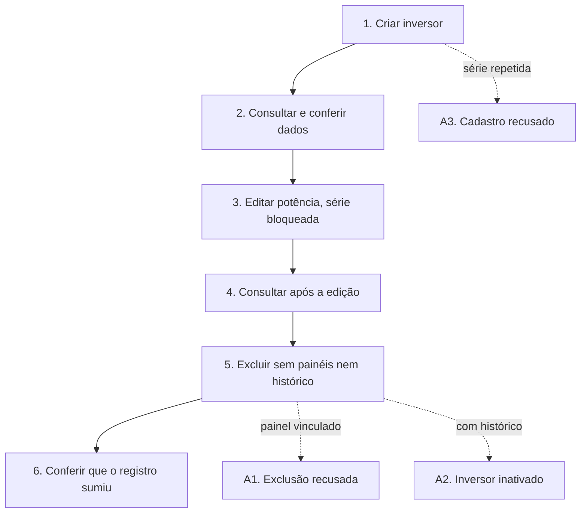
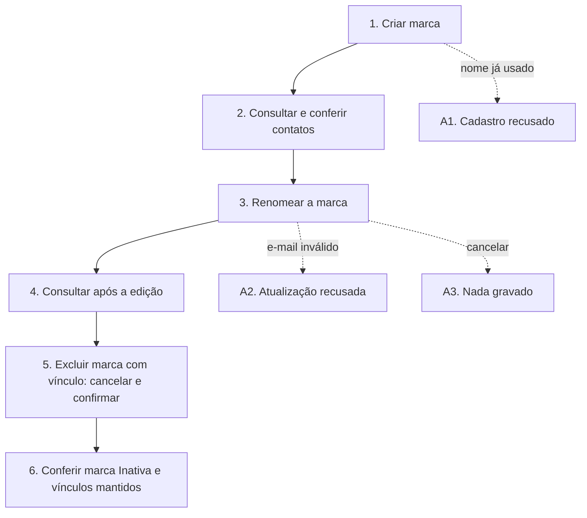
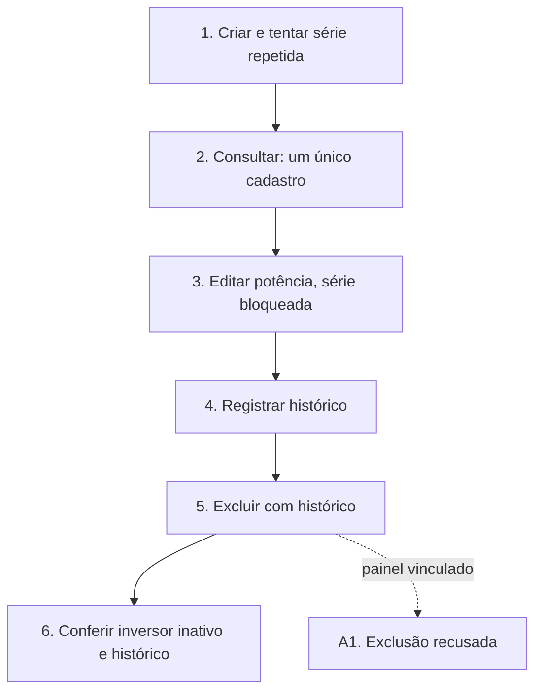
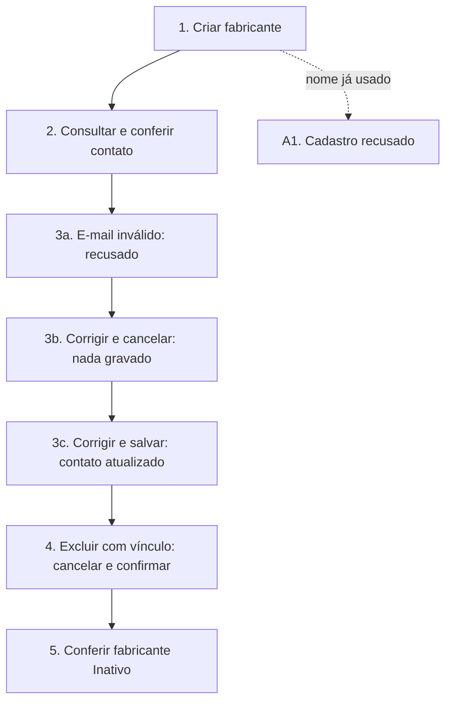
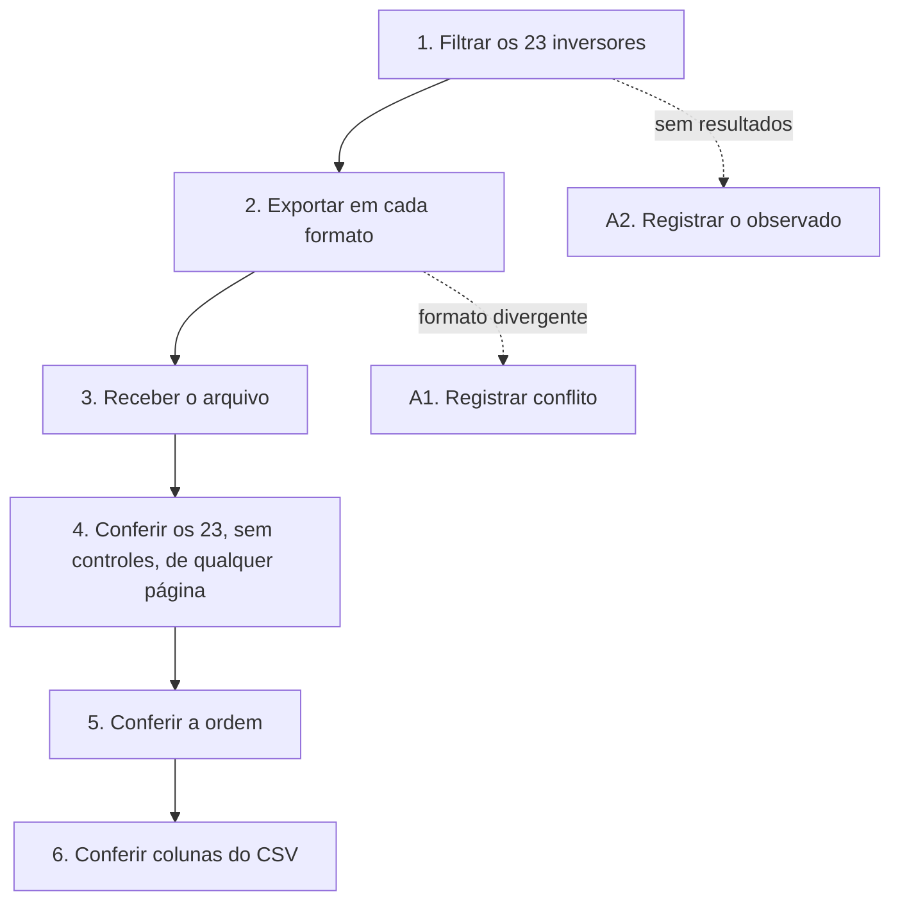
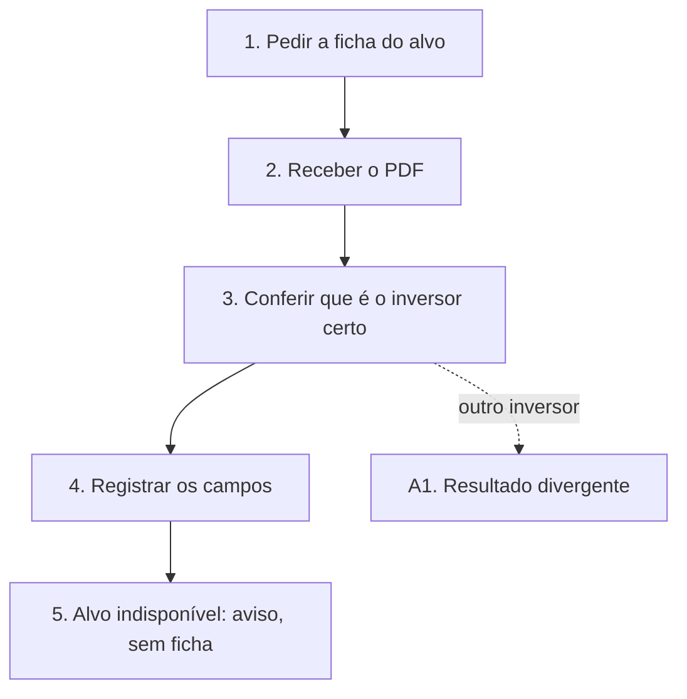
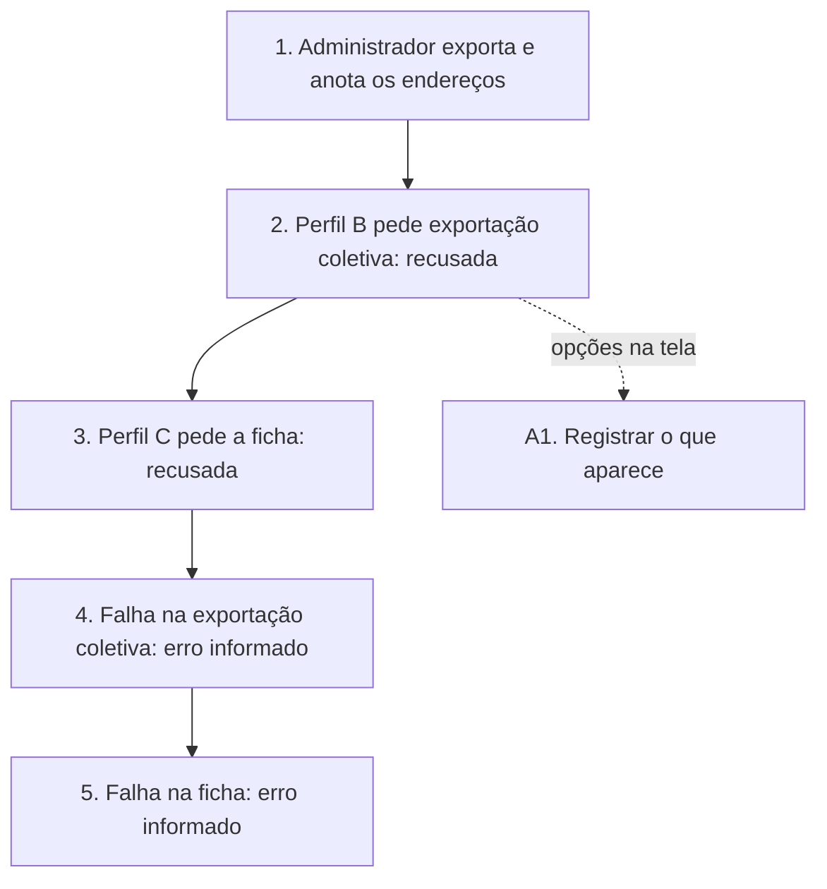
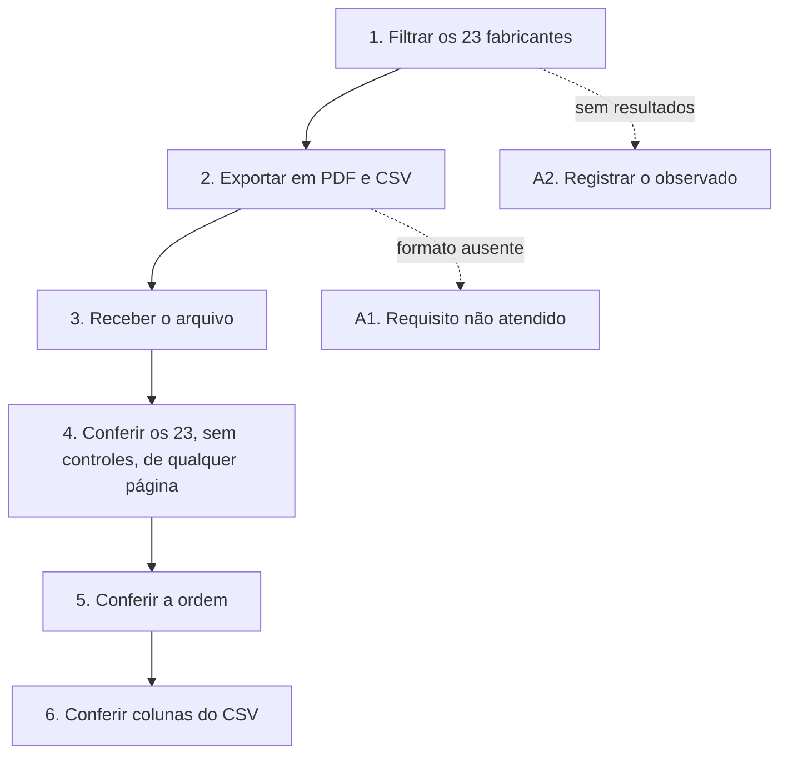
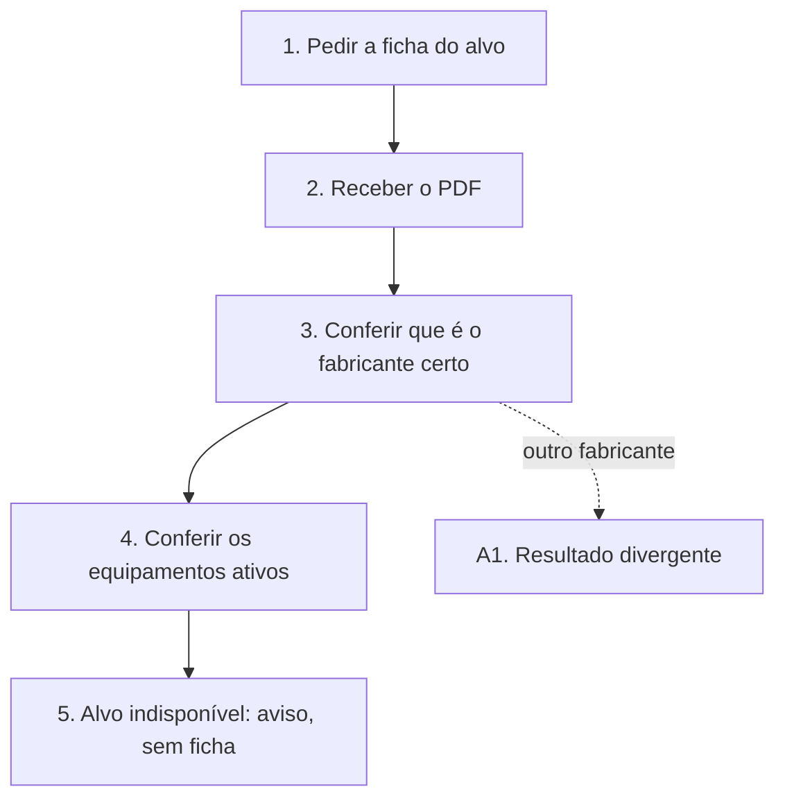
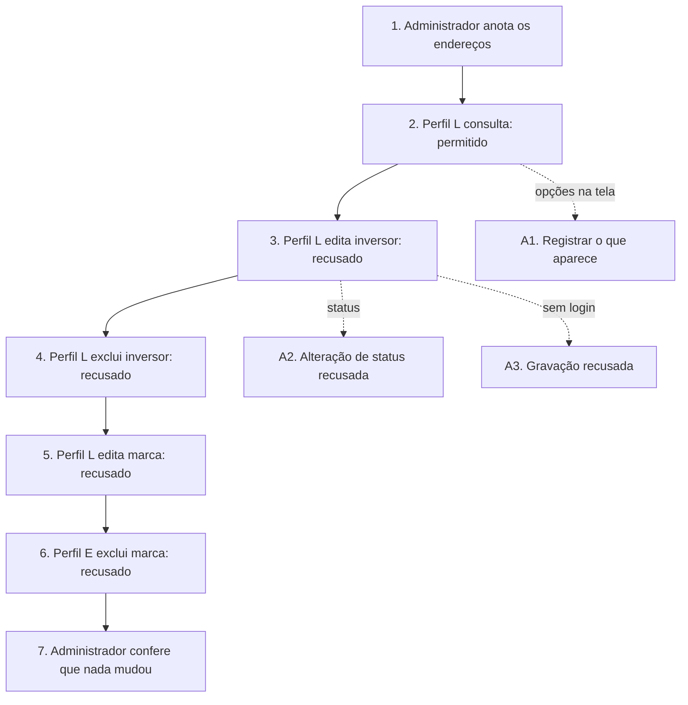

# BVAPP — Cenários de teste de Diogo

Mini projeto individual da atividade **Elaboração de cenários de teste do BVapp**,
da disciplina Verificação, Validação e Teste de Software.

**Responsável acadêmico:** Diogo Bruno Ferreira Martins de Aguiar. **Data:** 05/11/2026.

São **11 cenários documentais**: quatro CRUD completos, com objetivos distintos,
seis cenários de exportação e um cenário negativo de controle de acesso. O recorte individual confirmado é **inversores e
fabricantes (marcas)**. Cada `.py` segue o formato do exemplo do professor: um
cabeçalho com identificador, objetivo, requisitos e ator, seguido do fluxo principal
`[FP]`, dos fluxos alternativos `[A1]`, `[A2]`… e das regras de negócio `[RN1]`,
`[RN2]`…, citados no ponto do fluxo em que se aplicam. Pré-condições, dados de teste,
bloqueios e pendências de cada cenário ficam na especificação completa em
[docs/fluxos](docs/fluxos.md) e em [pendências](docs/pendencias.md).

**Não há implementação, interface, teste automatizado ou teste executado.** Os `.py`
guardam somente documentação, conforme o exemplo do professor. Não é necessário
instalar Python ou Django para ler. A árvore usa `config/` e `functional_tests/`
como inspiração de organização, com os grupos de Ativos em subpastas. Nenhum `manage.py`,
modelo, view ou template foi criado porque a entrega atual não os exige.

## Cenários

Veja os [fluxos em Markdown](docs/fluxos.md), com a descrição completa de cada cenário, ou os diagramas nesta página.

| Identificador | Arquivo | Natureza |
| --- | --- | --- |
| UCS001 | [Manter inversores](functional_tests/ativos/inversores/UCS001_manter_inversores.py) | CRUD completo |
| UCS002 | [Manter marcas](functional_tests/ativos/marcas/UCS002_manter_marcas.py) | CRUD completo |
| UCS003 | [Manter inversor com validação de unicidade e histórico](functional_tests/ativos/inversores/UCS003_crud_variacao.py) | CRUD completo |
| UCS004 | [Manter fabricante com validação de contato e cancelamento](functional_tests/ativos/marcas/UCS004_crud_variacao.py) | CRUD completo |
| UCS005 | [Exportar consulta filtrada de inversores em todos os formatos](functional_tests/ativos/inversores/UCS005_exportacao_1.py) | Exportação |
| UCS006 | [Exportar ficha individual de inversores](functional_tests/ativos/inversores/UCS006_exportacao_2.py) | Exportação |
| UCS007 | [Tratar autorização e falha de exportação de inversores](functional_tests/ativos/inversores/UCS007_exportacao_3.py) | Exportação |
| UCS008 | [Exportar consulta filtrada de fabricantes em todos os formatos](functional_tests/ativos/marcas/UCS008_exportacao_1.py) | Exportação |
| UCS009 | [Exportar ficha individual de fabricantes](functional_tests/ativos/marcas/UCS009_exportacao_2.py) | Exportação |
| UCS010 | [Tratar autorização e falha de exportação de fabricantes](functional_tests/ativos/marcas/UCS010_exportacao_3.py) | Exportação |
| UCS011 | [Recusar edição e exclusão por acesso direto sem permissão](functional_tests/ativos/UCS011_acesso_direto_sem_permissao.py) | Controle de acesso |

## Como revisar

1. Ler [escopo e fontes](docs/escopo-e-fontes.md).
2. Abrir um cenário pelo índice; seguir as quatro operações no mesmo arquivo quando CRUD.
3. Consultar a [matriz de rastreabilidade](docs/matriz-rastreabilidade.md).
4. Tratar as [pendências](docs/pendencias.md) antes de aprovar resultados dependentes.

Os cenários foram preparados com assistência de IA a partir dos requisitos identificados.
A revisão pessoal, a validação das decisões de negócio e a apresentação ainda não são
declaradas realizadas. A atribuição de responsabilidade acadêmica não comprova execução.

O pacote não contém código do produto, arquivos privados de origem, dados reais de
usuários ou credenciais. A leitura dos cenários é autossuficiente para a avaliação.

## Revisão dos requisitos — 06/11/2026

Os dez cenários foram revisados contra a base `5f3072939bb7ce5f90b64bf0faa5483bbb0d3260`. Exportações agora referenciam as Features #35875 (inversores) e #35912 (fabricantes). Veja a [matriz com IDs](docs/matriz-rastreabilidade.md) e as [pendências por cenário](docs/pendencias.md). Etapas com regra pendente ficam bloqueadas para aceite; o conflito Excel/CSV não foi resolvido por suposição. Este pacote contém documentação, sem execução de testes ou entrega no Classroom.

O UCS011 foi acrescentado na mesma data e base. Ele verifica, para inversores e fabricantes, que perfis sem a autorização correspondente são recusados ao solicitar edição ou exclusão diretamente, sem usar os controles da tela. As recusas esperadas vêm dos critérios de autorização já existentes (CA-2.1.1.2.01, CA-2.1.1.3.01, CA-2.1.1.4.01, CA-2.1.4.1.3.01 e CA-2.1.4.1.4.01); nenhuma regra nova foi criada.

## Fluxos visuais

Cada diagrama mostra o fluxo principal (setas cheias) e os fluxos alternativos (setas tracejadas). Dados de teste, resultados esperados e regras de cada passo estão no fluxo completo do cenário.

### UCS001 — Manter inversores

[Ver fluxo completo](docs/fluxos/UCS001_manter_inversores.md)

### UCS002 — Manter marcas

[Ver fluxo completo](docs/fluxos/UCS002_manter_marcas.md)

### UCS003 — Manter inversor com validação de unicidade e histórico

[Ver fluxo completo](docs/fluxos/UCS003_crud_variacao.md)

### UCS004 — Manter fabricante com validação de contato e cancelamento

[Ver fluxo completo](docs/fluxos/UCS004_crud_variacao.md)

### UCS005 — Exportar consulta filtrada de inversores em todos os formatos

[Ver fluxo completo](docs/fluxos/UCS005_exportacao_1.md)

### UCS006 — Exportar ficha individual de inversores

[Ver fluxo completo](docs/fluxos/UCS006_exportacao_2.md)

### UCS007 — Tratar autorização e falha de exportação de inversores

[Ver fluxo completo](docs/fluxos/UCS007_exportacao_3.md)

### UCS008 — Exportar consulta filtrada de fabricantes em todos os formatos

[Ver fluxo completo](docs/fluxos/UCS008_exportacao_1.md)

### UCS009 — Exportar ficha individual de fabricantes

[Ver fluxo completo](docs/fluxos/UCS009_exportacao_2.md)

### UCS010 — Tratar autorização e falha de exportação de fabricantes

[Ver fluxo completo](docs/fluxos/UCS010_exportacao_3.md)

### UCS011 — Recusar edição e exclusão por acesso direto sem permissão

[Ver fluxo completo](docs/fluxos/UCS011_acesso_direto_sem_permissao.md)

