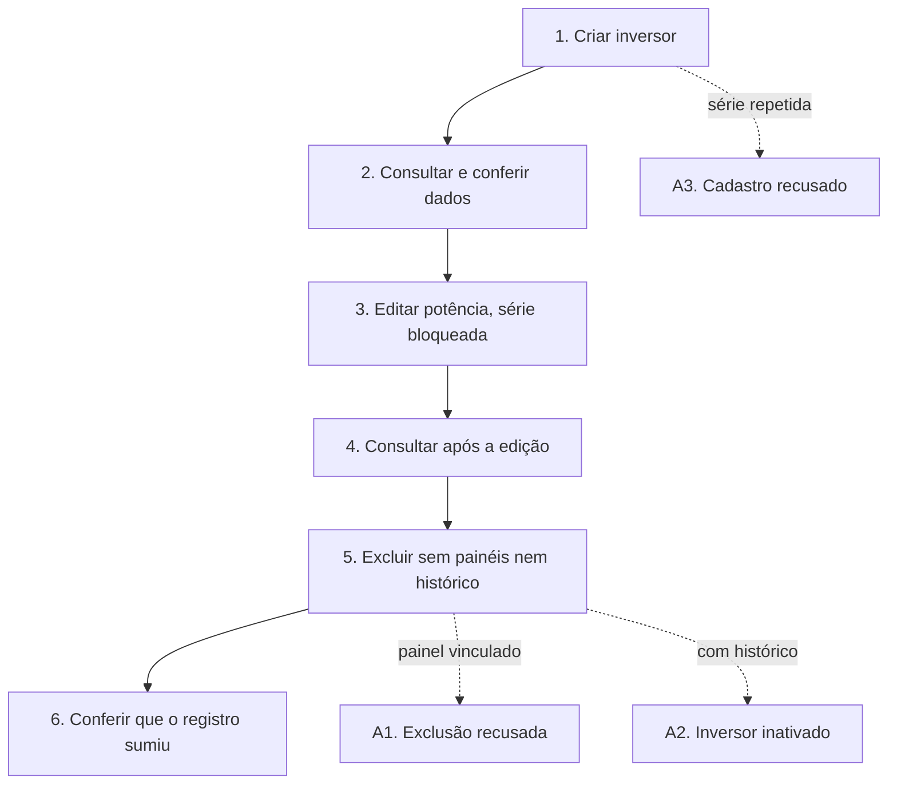

# UCS001 — Manter inversores

[Índice de fluxos](../fluxos.md) · [README](../../README.md) · [Cenário no formato do professor (.py)](../../functional_tests/ativos/inversores/UCS001_manter_inversores.py) · [Pendências](../pendencias.md#ucs001)

## Objetivo

Percorrer, num único cenário, o ciclo completo de cadastrar, consultar, atualizar e excluir um inversor.

## Requisitos

- Features do OpenProject: #24233 (Inclusão), #24249 (Consulta), #24253 (Atualização) e #24254 (Exclusão).
- Critérios da consolidação local: CA-2.1.1.1.01, .02, .03, .04, .07, .10, .12, .17; CA-2.1.1.2.01, .08; CA-2.1.1.3.02, .04, .14; CA-2.1.1.4.01, .02, .03, .04, .06, .07.

## Ator

Administrador. Os requisitos permitem inclusão, listagem, visualização e edição a qualquer usuário autenticado e autorizado, e reservam a exclusão ao Administrador ou Gerente; o cenário usa o Administrador porque ele tem todas essas autorizações.

## Pré-condições

- Ambiente de teste isolado, com massa fictícia.
- Marca, modelo, fornecedor, usina e operadora de estudo já cadastrados e ativos.

## Dados de teste

| Campo | Valor |
| --- | --- |
| Número de série | INV-ESTUDO-001 |
| Marca / Modelo | Marca Estudo A / Modelo Estudo A (pertence à marca) |
| Fornecedor / Usina / Operadora | Fornecedor Estudo A / Usina Estudo A / Operadora Estudo A |
| Potência nominal | 5 kW (6 kW na edição) |
| Instalação | 01/10/2026 |
| Situação | Ativo |
| Garantia de instalação | Valor e unidade pendentes |

## Fluxo principal

1. **Criar.** Preencher os dados obrigatórios e salvar. **Esperado:** inversor criado e mensagem «Inversor cadastrado com sucesso e vinculado à Operadora e Localização selecionadas».
2. **Consultar.** Buscar INV-ESTUDO-001 e abrir o registro. **Esperado:** série, marca, modelo, potência, instalação e situação iguais aos cadastrados.
3. **Atualizar.** Abrir a edição, conferir que a série não pode ser alterada, mudar a potência para 6 kW e salvar. **Esperado:** mensagem «Dados do inversor atualizados com sucesso».
4. **Consultar após a atualização.** **Esperado:** a mesma série com 6 kW e os demais dados preservados.
5. **Excluir.** Com o inversor sem painéis vinculados e sem histórico, solicitar a exclusão, conferir série e marca na confirmação e confirmar. **Esperado:** registro removido e mensagem «Inversor removido/inativado com sucesso».
6. **Consultar após a exclusão.** **Esperado:** o inversor não aparece na consulta, e o acesso direto ao registro informa que ele não existe.

## Fluxos alternativos

- **A1. Painel vinculado.** Solicitar a exclusão de um inversor com painel associado. **Esperado:** exclusão recusada, impedimento informado e inversor preservado (CA-2.1.1.4.02, a validar).
- **A2. Histórico existente.** Solicitar a exclusão de um inversor sem painel, mas com histórico de geração ou manutenção. **Esperado:** inversor inativado, e não removido, com o histórico preservado (CA-2.1.1.4.03).
- **A3. Série repetida.** Cadastrar outro inversor com a série INV-ESTUDO-001. **Esperado:** cadastro recusado e duplicidade informada (CA-2.1.1.1.04).

## Regras de negócio

- Dados obrigatórios (#24403) e série única entre inversores (#24416).
- Na edição, a série é somente leitura; continuam valendo a obrigatoriedade e a potência positiva (#24462).
- A exclusão é restrita a Administrador ou Gerente (#24473).
- Sem painéis e sem histórico, o inversor é removido; com painel, a exclusão é recusada; com histórico, ele é inativado (CA-2.1.1.4.01 a .03).

## Diagrama

## Pendências

Unidade da garantia de instalação, equivalência dos perfis Administrador/Gerente e aprovação da recusa por painel vinculado. Detalhes em [pendências do UCS001](../pendencias.md#ucs001).
