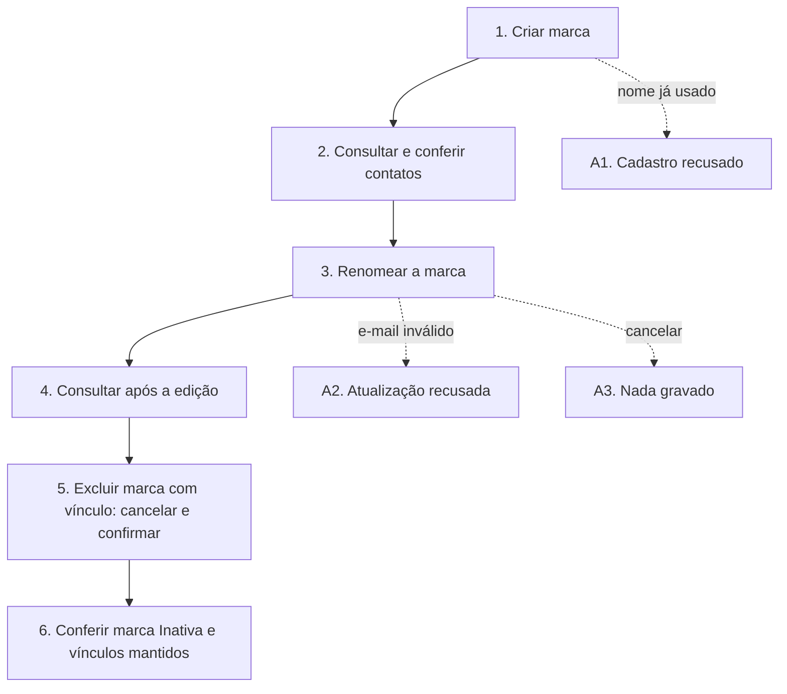

# UCS002 — Manter marcas

[Índice de fluxos](../fluxos.md) · [README](../../README.md) · [Cenário no formato do professor (.py)](../../functional_tests/ativos/marcas/UCS002_manter_marcas.py) · [Pendências](../pendencias.md#ucs002)

## Objetivo

Percorrer, num único cenário, o ciclo completo de cadastrar, consultar, atualizar e excluir uma marca (fabricante).

## Requisitos

- Features do OpenProject: #24272 (Inclusão), #24273 (Consulta), #24275 (Atualização) e #24278 (Exclusão).
- Critérios da consolidação local: CA-2.1.4.1.1.01, .02, .03, .05, .06, .11; CA-2.1.4.1.2.01, .04, .09; CA-2.1.4.1.3.02, .03, .04, .05, .11; CA-2.1.4.1.4.01, .02, .03, .04, .07.

## Ator

Administrador. Os requisitos permitem adicionar, listar, visualizar e editar marcas a qualquer usuário autorizado, e reservam a remoção a administradores; o cenário usa o Administrador porque ele tem todas essas autorizações.

## Pré-condições

- Ambiente de teste isolado, com massa fictícia.
- Um modelo de estudo disponível para ser vinculado à marca antes da exclusão.

## Dados de teste

| Campo | Valor |
| --- | --- |
| Nome | Marca Estudo A (Marca Estudo A Revisada na edição) |
| Identificação internacional | Tipo e ID ID-ESTUDO-A (formato pendente); nenhum CNPJ real |
| Situação | Ativo |
| E-mail de suporte | suporte@example.invalid |
| Site e telefone | Em branco |

## Fluxo principal

1. **Criar.** Preencher nome, identificação e situação, deixar site e telefone em branco e salvar. **Esperado:** mensagem «Marca cadastrada com sucesso» e inclusão registrada na auditoria.
2. **Consultar.** Buscar a marca pelo nome e abrir o detalhe. **Esperado:** nome e e-mail corretos; contatos não informados aparecem como "Não informado" (a validar).
3. **Atualizar.** Mudar o nome para Marca Estudo A Revisada, mantendo o e-mail, e salvar. **Esperado:** mensagem «Marca atualizada com sucesso» e valores anterior e posterior registrados na auditoria.
4. **Consultar após a atualização.** **Esperado:** a mesma marca com o novo nome e os demais dados preservados.
5. **Excluir.** Vincular o modelo de estudo à marca. Solicitar a exclusão, conferir o nome na confirmação, cancelar uma vez e, em seguida, solicitar de novo e confirmar. **Esperado:** o cancelamento não altera nada; após a confirmação, a marca fica Inativa e os vínculos são mantidos.
6. **Consultar após a exclusão.** **Esperado:** a marca aparece como Inativa e continua identificada nos cadastros que a usam.

## Fluxos alternativos

- **A1. Nome já usado.** Cadastrar outra marca com um nome existente. **Esperado:** cadastro recusado (CA-2.1.4.1.1.06).
- **A2. E-mail inválido.** Na edição, informar um e-mail sem formato válido e salvar. **Esperado:** atualização recusada (CA-2.1.4.1.3.05).
- **A3. Cancelar a edição.** Alterar o nome e cancelar. **Esperado:** a alteração não é gravada (CA-2.1.4.1.3.04).

## Regras de negócio

- Nome, identificação internacional e situação são obrigatórios; site e telefone são opcionais (#24545). A situação aceita Ativo ou Inativo (#24553).
- O nome é único, na inclusão e na edição (#24556, #24591).
- O e-mail de suporte precisa ter formato válido.
- Somente administradores excluem marcas (#24595). Com vínculos, a marca é inativada; sem vínculos, a exclusão é física (US #24600).
- Inclusão, alteração e exclusão são registradas na auditoria.

## Diagrama

## Pendências

Formato do ID internacional, texto "Não informado" e forma de comprovar a exclusão física sem vínculos. Detalhes em [pendências do UCS002](../pendencias.md#ucs002).
