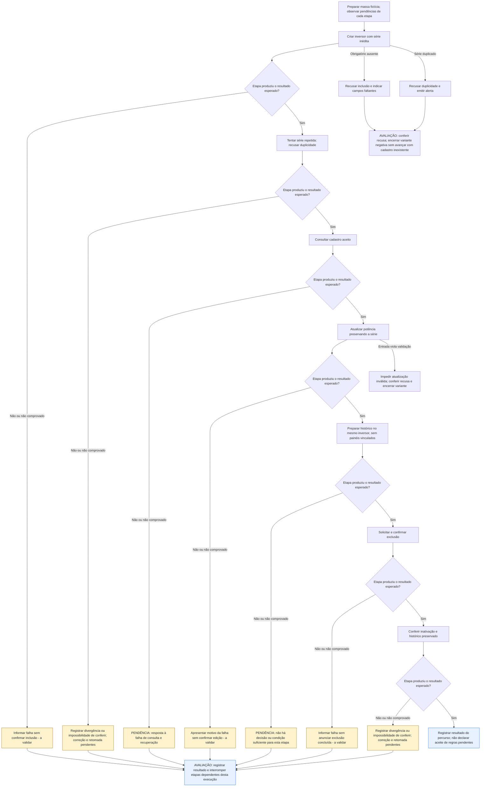

# UCS003 — Manter inversor com validação de unicidade e histórico

[Índice de fluxos](../fluxos.md) · [README](../../README.md) · [Cenário no formato do professor (.py)](../../functional_tests/ativos/inversores/UCS003_crud_variacao.py)

Os losangos representam a avaliação da etapa no cenário, não novos controles da interface. **Falha esperada e corretamente tratada pode atender ao cenário negativo.** Uma falha inesperada interrompe apenas as etapas dependentes desta execução. Essa interrupção é uma orientação de teste, não uma regra do sistema. Não há repetição automática, rollback, preservação de campos ou retomada presumidos. Os acréscimos marcados **a validar** continuam sujeitos ao aceite dos stakeholders.

## Fluxo visual

## Falhas, recusas e pendências por etapa

As referências CAxx abaixo são rótulos dentro da Feature indicada, não IDs globais novos. Uma mensagem de falha não comprova que nenhuma gravação ocorreu; em perda de resposta, o estado final permanece a verificar.

| Etapa ou variante | Resposta prevista ou pendência | Base |
| --- | --- | --- |
| 1. Criar inversor com série inédita | Informar falha sem confirmar inclusão - a validar. Não continuar etapas dependentes. | #24233 CA15, acréscimo a validar |
| Inclusão recusada por entrada inválida | Não concluir inclusão; indicar campos obrigatórios faltantes ou alertar duplicidade. Recusa correta é resultado esperado da variante negativa. | #24403 e #24416 |
| 2. Tentar série repetida: recusar duplicidade | Registrar divergência ou impossibilidade de conferir; correção e retomada pendentes. Não continuar etapas dependentes. | Resultados esperados do cenário; não há resposta automática definida para divergência constatada pelo avaliador |
| 3. Consultar cadastro aceito | PENDÊNCIA: resposta à falha de consulta e recuperação. Não continuar etapas dependentes. | Consolidação de Consulta: tratamento detalhado e recuperação pendentes |
| 4. Atualizar potência preservando a série | Apresentar motivo da falha sem confirmar edição - a validar. Não continuar etapas dependentes. | #24253 CA12, acréscimo a validar |
| Atualização recusada por validação | Não confirmar a gravação inválida; não inferir preservação dos campos digitados ou política de nova tentativa. | #24462: obrigatoriedade e potência positiva |
| 5. Preparar histórico no mesmo inversor, sem painéis vinculados | PENDÊNCIA: não há decisão ou condição suficiente para esta etapa. Não continuar etapas dependentes. | Pendências do próprio cenário; não é falha comprovada do sistema |
| 6. Solicitar e confirmar exclusão | Informar falha sem anunciar exclusão concluída - a validar. Não continuar etapas dependentes. | #24254 CA09, acréscimo a validar |
| 7. Conferir inativação e histórico preservado | Registrar divergência ou impossibilidade de conferir; correção e retomada pendentes. Não continuar etapas dependentes. | Resultados esperados do cenário; não há resposta automática definida para divergência constatada pelo avaliador |

## Especificação completa

Autoria / responsável acadêmico: Diogo Bruno Ferreira Martins de Aguiar
Preparação: assistência de IA; revisão pessoal e apresentação pelo responsável pendentes.
Revisão documental: 06/11/2026. Criação: 05/11/2026
Natureza: especificação documental, não teste automatizado nem evidência de execução.
Revisão-base: 5f3072939bb7ce5f90b64bf0faa5483bbb0d3260
Grupo de requisitos: Gestão de Inversores (a numeração da fonte é preservada).

### OBJETIVO

Exercitar o ciclo CRUD completo quando há tentativa de série duplicada e histórico
que muda o resultado da exclusão para inativação. O objetivo é proteger a identidade
do inversor e seus registros históricos, diferente da remoção sem histórico de UCS001.

### REQUISITOS RELACIONADOS

Features do OpenProject: #24233 (Inclusão), #24249 (Consulta), #24253 (Atualização) e #24254 (Exclusão).
Referências locais da consolidação (não são IDs do OpenProject): CA-2.1.1.1.01, CA-2.1.1.1.02, CA-2.1.1.1.03, CA-2.1.1.1.04, CA-2.1.1.1.07, CA-2.1.1.1.10, CA-2.1.1.1.12, CA-2.1.1.1.17, CA-2.1.1.2.01, CA-2.1.1.2.08, CA-2.1.1.3.02, CA-2.1.1.3.04, CA-2.1.1.3.14, CA-2.1.1.4.01, CA-2.1.1.4.02, CA-2.1.1.4.03, CA-2.1.1.4.04, CA-2.1.1.4.06, CA-2.1.1.4.07.

### SITUAÇÃO DAS REGRAS E BLOQUEIOS

Aplicam-se as pendências de UCS001: garantias, elegibilidade dos vínculos e matriz de autorizações. A unicidade de série entre inversores tem origem no CA #24416; alcance a outros tipos e registros excluídos é acréscimo a validar. O fluxo com histórico usa #24475, mas depende da definição de quais registros caracterizam histórico e de sua preparação. A recusa por painéis vinculados é acréscimo a validar, inclusive a precedência quando também há histórico.
Resultados de acréscimos a validar são expectativas propostas. Não aprovar essas etapas antes da decisão registrada dos stakeholders. IDs globais e rótulos locais são distinguidos em docs/matriz-rastreabilidade.md.

### ATOR

Usuário autenticado com autorização de inclusão, listagem, visualização e edição; na exclusão, Administrador ou Gerente conforme a fonte. A equivalência dos perfis permanece pendente.

### PRÉ-CONDIÇÕES

- Ambiente futuro de estudo isolado, sem dados de produção ou ações reais nesta entrega.
- Meio de preparação do histórico de geração/manutenção definido para o ambiente
  de estudo; ele será aplicado ao inversor criado neste fluxo antes da exclusão.
- Massa sintética e vínculos preparados antes do fluxo; nenhum registro de controle é alterado.
- A autorização é verificada por operação, não inferida do acesso à listagem.
- Tratar as decisões em aberto abaixo antes de aprovar as etapas dependentes.

### DADOS DE TESTE

Número de Série INV-ESTUDO-HIST-001; Marca Marca Estudo A; Modelo Modelo Estudo A pertencente à Marca; Fornecedor Fornecedor Estudo A; Usina Usina Estudo A; Operadora Operadora Estudo A; Potência Nominal 5 kW; Instalação 01/10/2026; Situação Ativo. Todos os vínculos são referências sintéticas previamente cadastradas e ativas. Garantia de instalação: valor e unidade dependem da pendência indicada abaixo; não usar um número arbitrário como regra aprovada.
Os nomes e valores são fictícios e servem apenas de exemplo de entrada. Não constituem
novos limites, domínios, permissões ou regras de negócio.

### [FP] FLUXO PRINCIPAL — CRUD COMPLETO

1. CRIAR. Em massa isolada, cadastrar INV-ESTUDO-HIST-001 com os dados obrigatórios
   descritos acima e série inédita. Esperado: um inversor criado. Tentar nova inclusão
   com a mesma série: recusa e nenhum segundo cadastro (CA-2.1.1.1.04).
2. CONSULTAR. Localizar a série, abrir o detalhe e conferir que há apenas o cadastro
   aceito, com marca, modelo e potência informados (CA-2.1.1.2.01 e .08).
3. ATUALIZAR. Abrir a edição; a série continua somente para leitura. Mudar a potência
   de 5 para 6 kW, salvar e reabrir o detalhe: mesma série e nova potência
   (CA-2.1.1.3.02 e .04). Não há alteração de identidade.
4. PREPARAR A CONDIÇÃO DE EXCLUSÃO. Após a criação e atualização, preparar histórico
   de geração/manutenção associado ao MESMO INV-ESTUDO-HIST-001, pelo meio acordado
   para a massa de estudo. Identificar esse histórico e conferir sua consulta antes
   de prosseguir; manter o inversor sem painéis vinculados. Se a preparação ou a
   consulta do histórico não estiver definida, bloquear a próxima etapa.
5. EXCLUIR. Para esse mesmo inversor com histórico de geração/manutenção e sem painel
   vinculado, solicitar exclusão e confirmar os dados da confirmação. Esperado:
   inativação, preservação do cadastro e do histórico (CA-2.1.1.4.01 e .03).
6. CONSULTAR APÓS EXCLUSÃO. Localizar o registro inativo e conferir sua identidade
   e a conservação do histórico pelo meio de consulta que for acordado. Ausência
   numa lista filtrada de ativos não comprova preservação nem exclusão física.

### [A] FLUXOS ALTERNATIVOS

1. Painel vinculado. Preparar variante com painel associado e solicitar exclusão. Esperado: recusa, informação do impedimento e inversor preservado. Referência: CA-2.1.1.4.02.
2. Histórico existente. Sem painel associado, mas com histórico de geração/manutenção: a operação de exclusão deve inativar e preservar o histórico, em vez de remover definitivamente. Referência: CA-2.1.1.4.03.
3. Série repetida. Tentar cadastrar uma segunda referência com INV-ESTUDO-HIST-001. Esperado: impedir duplicidade e informar o problema; não criar outro inversor. Referência: CA-2.1.1.1.04.

### [A-COM] CONCORRÊNCIA E INTERRUPÇÃO

Se outra pessoa alterar o cadastro durante o fluxo, ou ocorrer perda de resposta,
registrar o ponto interrompido e a dúvida. Não escolher prevalência, prazo, repetição
automática ou recuperação que não esteja definida. Os resultados dessas variantes
permanecem pendentes de especificação; não são cenários aprovados.

### REGRAS DE NEGÓCIO E ORÁCULO

- Os resultados originais vêm dos CAs relacionados; os acréscimos estão explicitamente sujeitos à validação indicada acima.
- O cadastro em uma operação não concede autorização para as operações seguintes.
- Cancelamento e bloqueio não devem ser descritos como conclusão bem-sucedida.
- O comportamento específico de exclusão do grupo não é generalizado a outro grupo.

### RESULTADOS ESPERADOS E REGISTRO FUTURO

- Comparar entrada, consulta inicial, consulta após edição e resultado da exclusão.
- Em futura execução, anotar versão, data, massa, passo, esperado, observado e evidência.
- Nesta entrega: nenhum resultado observado; nenhum teste executado; sem homologação.
- Se uma pendência impedir decidir entre aceitar e recusar, marcar BLOQUEADO,
  identificar a decisão necessária e não converter o caso em sucesso.

### PENDÊNCIAS PARA STAKEHOLDERS

Unidade da garantia e conciliação da garantia de instalação obrigatória; equivalência dos perfis Administrador/Gerente; identificação de histórico; forma de comprovar remoção definitiva; concorrência e perda de resposta. O fluxo CRUD está descrito por completo, mas as etapas que dependem dessas definições não recebem aprovação presumida.
