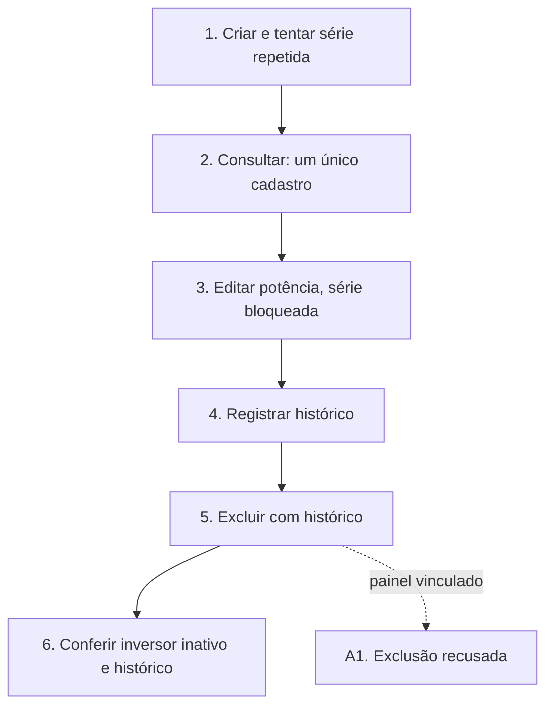

# UCS003 — Manter inversor com validação de unicidade e histórico

[Índice de fluxos](../fluxos.md) · [README](../../README.md) · [Cenário no formato do professor (.py)](../../functional_tests/ativos/inversores/UCS003_crud_variacao.py) · [Pendências](../pendencias.md#ucs003)

## Objetivo

Percorrer o ciclo completo de um inversor quando há tentativa de série duplicada e quando o histórico transforma a exclusão em inativação. Diferente do UCS001, que remove um inversor sem histórico.

## Requisitos

- Features do OpenProject: #24233 (Inclusão), #24249 (Consulta), #24253 (Atualização) e #24254 (Exclusão).
- Critérios da consolidação local: CA-2.1.1.1.01, .02, .03, .04, .07, .10, .12, .17; CA-2.1.1.2.01, .08; CA-2.1.1.3.02, .04, .14; CA-2.1.1.4.01, .02, .03, .04, .06, .07.

## Ator

Administrador. Os requisitos permitem inclusão, listagem, visualização e edição a qualquer usuário autenticado e autorizado, e reservam a exclusão ao Administrador ou Gerente; o cenário usa o Administrador porque ele tem todas essas autorizações.

## Pré-condições

- Ambiente de teste isolado, com massa fictícia.
- Marca, modelo, fornecedor, usina e operadora de estudo já cadastrados e ativos.
- Meio definido para registrar histórico de geração ou manutenção no ambiente de teste.

## Dados de teste

| Campo | Valor |
| --- | --- |
| Número de série | INV-ESTUDO-HIST-001 |
| Marca / Modelo | Marca Estudo A / Modelo Estudo A (pertence à marca) |
| Fornecedor / Usina / Operadora | Fornecedor Estudo A / Usina Estudo A / Operadora Estudo A |
| Potência nominal | 5 kW (6 kW na edição) |
| Instalação | 01/10/2026 |
| Situação | Ativo |

## Fluxo principal

1. **Criar e tentar duplicar.** Cadastrar o inversor com série inédita e, depois, tentar cadastrar outro com a mesma série. **Esperado:** o primeiro é criado; o segundo é recusado, sem gerar novo cadastro (CA-2.1.1.1.04).
2. **Consultar.** Localizar a série e abrir o registro. **Esperado:** um único cadastro, com marca, modelo e potência informados (CA-2.1.1.2.01 e .08).
3. **Atualizar.** Abrir a edição, conferir que a série é somente leitura, mudar a potência para 6 kW e salvar. **Esperado:** a mesma série exibe 6 kW (CA-2.1.1.3.02 e .04).
4. **Preparar o histórico.** Registrar um histórico de geração ou manutenção para o mesmo inversor e conferir que ele aparece na consulta. O inversor continua sem painéis vinculados. Se não houver meio definido para isso, a etapa 5 fica bloqueada.
5. **Excluir.** Solicitar a exclusão, conferir os dados na confirmação e confirmar. **Esperado:** inversor inativado, com cadastro e histórico preservados (CA-2.1.1.4.01 e .03).
6. **Consultar após a exclusão.** **Esperado:** o inversor aparece como inativo, com a identificação e o histórico disponíveis.

## Fluxos alternativos

- **A1. Painel vinculado.** Solicitar a exclusão de uma variante com painel associado. **Esperado:** exclusão recusada, impedimento informado e inversor preservado (CA-2.1.1.4.02, a validar).

## Regras de negócio

- A série é única entre inversores (#24416) e somente leitura na edição.
- Inversor com histórico é inativado, e não removido (#24475).
- Inversor com painel vinculado não pode ser excluído (a validar, inclusive quando também há histórico).
- A exclusão é restrita a Administrador ou Gerente (#24473).

## Diagrama

## Pendências

Quais registros caracterizam histórico e como prepará-los; precedência entre painel vinculado e histórico. Detalhes em [pendências do UCS003](../pendencias.md#ucs003).
