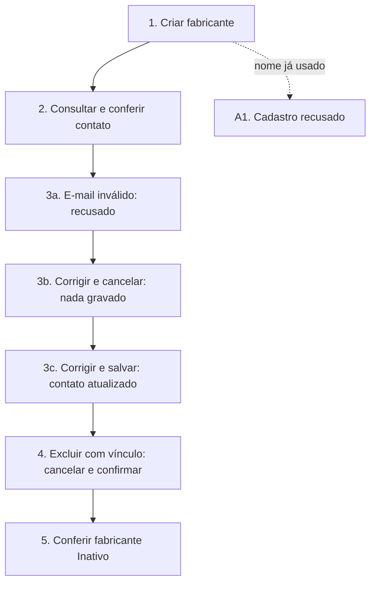

# UCS004 — Manter fabricante com validação de contato e cancelamento

[Índice de fluxos](../fluxos.md) · [README](../../README.md) · [Cenário no formato do professor (.py)](../../functional_tests/ativos/marcas/UCS004_crud_variacao.py) · [Pendências](../pendencias.md#ucs004)

## Objetivo

Percorrer o ciclo completo de um fabricante com e-mail inválido e desistência na edição e na exclusão, garantindo que nada inválido ou cancelado seja gravado.

## Requisitos

- Features do OpenProject: #24272 (Inclusão), #24273 (Consulta), #24275 (Atualização) e #24278 (Exclusão).
- Critérios da consolidação local: CA-2.1.4.1.1.01, .02, .03, .05, .06, .11; CA-2.1.4.1.2.01, .04, .09; CA-2.1.4.1.3.02, .03, .04, .05, .11; CA-2.1.4.1.4.01, .02, .03, .04, .07.

## Ator

Administrador. Os requisitos permitem adicionar, listar, visualizar e editar marcas a qualquer usuário autorizado, e reservam a remoção a administradores; o cenário usa o Administrador porque ele tem todas essas autorizações.

## Pré-condições

- Ambiente de teste isolado, com massa fictícia.
- Um modelo de estudo disponível para ser vinculado ao fabricante antes da exclusão.

## Dados de teste

| Campo | Valor |
| --- | --- |
| Nome | Marca Estudo Cancelamento |
| Identificação internacional | Tipo e ID ID-ESTUDO-A (formato pendente); nenhum CNPJ real |
| Situação | Ativo |
| E-mail de suporte | suporte@example.invalid; inválido: sem-arroba; novo: novo@example.invalid |
| Site e telefone | Em branco |

## Fluxo principal

1. **Criar.** Cadastrar o fabricante com identificação, situação e e-mail de suporte. **Esperado:** inclusão confirmada (CA-2.1.4.1.1.01, .02 e .03).
2. **Consultar.** Buscar pelo nome e abrir o detalhe. **Esperado:** identificação e contato corretos (CA-2.1.4.1.2.01 e .09).
3. **Atualizar.** Trocar o e-mail para sem-arroba e salvar: a atualização é recusada (CA-2.1.4.1.3.05). Corrigir para novo@example.invalid e cancelar: nada é gravado (CA-2.1.4.1.3.04). Reabrir, informar novo@example.invalid e salvar. **Esperado:** contato atualizado no mesmo fabricante, mensagem de sucesso e registro na auditoria (CA-2.1.4.1.3.02, .03 e .11).
4. **Excluir.** Vincular o modelo de estudo ao fabricante. Solicitar a exclusão e cancelar: o fabricante continua disponível. Solicitar de novo, conferir o nome e confirmar. **Esperado:** fabricante inativado, com as referências preservadas (CA-2.1.4.1.4.01 a .04).
5. **Consultar após a exclusão.** **Esperado:** fabricante Inativo e ainda identificado nos cadastros vinculados.

## Fluxos alternativos

- **A1. Nome já usado.** Cadastrar outra marca com um nome existente. **Esperado:** cadastro recusado (CA-2.1.4.1.1.06).

## Regras de negócio

- Nome, identificação internacional e situação são obrigatórios (#24545); a situação aceita Ativo ou Inativo (#24553).
- O nome é único (#24556).
- O e-mail de suporte precisa ter formato válido.
- Cancelar a edição ou a confirmação da exclusão não grava nada.
- Somente administradores excluem marcas (#24595). Com vínculos, o fabricante é inativado (US #24600).

## Diagrama

## Pendências

Formato do ID internacional e validação das regras de e-mail e cancelamento. Detalhes em [pendências do UCS004](../pendencias.md#ucs004).
