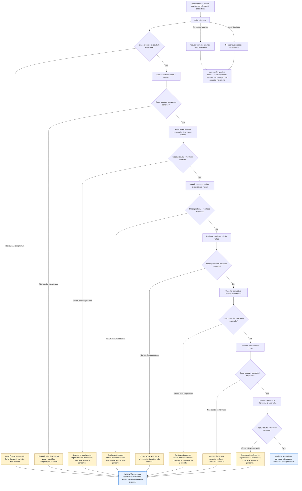

# UCS004 — Manter fabricante com validação de contato e cancelamento

[Índice de fluxos](../fluxos.md) · [README](../../README.md) · [Cenário no formato do professor (.py)](../../functional_tests/ativos/marcas/UCS004_crud_variacao.py)

Os losangos representam a avaliação da etapa no cenário, não novos controles da interface. **Falha esperada e corretamente tratada pode atender ao cenário negativo.** Uma falha inesperada interrompe apenas as etapas dependentes desta execução. Essa interrupção é uma orientação de teste, não uma regra do sistema. Não há repetição automática, rollback, preservação de campos ou retomada presumidos. Os acréscimos marcados **a validar** continuam sujeitos ao aceite dos stakeholders.

## Fluxo visual

## Falhas, recusas e pendências por etapa

As referências CAxx abaixo são rótulos dentro da Feature indicada, não IDs globais novos. Uma mensagem de falha não comprova que nenhuma gravação ocorreu; em perda de resposta, o estado final permanece a verificar.

| Etapa ou variante | Resposta prevista ou pendência | Base |
| --- | --- | --- |
| 1. Criar fabricante | PENDÊNCIA: resposta à falha técnica de inclusão não definida. Não continuar etapas dependentes. | #24272: critérios de obrigatoriedade e unicidade não definem a resposta a falha técnica |
| Inclusão recusada por entrada inválida | Não concluir inclusão; indicar campos obrigatórios faltantes ou alertar duplicidade. Recusa correta é resultado esperado da variante negativa. | #24545 e #24556 |
| 2. Consultar identificação e contato | Distinguir falha de consulta vazia - a validar; recuperação pendente. Não continuar etapas dependentes. | #24273 CA13, acréscimo a validar; recuperação não definida |
| 3. Tentar e-mail inválido: expectativa de recusa a validar | Registrar divergência ou impossibilidade de conferir; correção e retomada pendentes. Não continuar etapas dependentes. | Resultados esperados do cenário; não há resposta automática definida para divergência constatada pelo avaliador |
| 4. Corrigir e cancelar edição: expectativa a validar | Se alteração ocorrer apesar do cancelamento: divergência; recuperação pendente. Não continuar etapas dependentes. | Cancelamento descrito no cenário; acréscimo a validar, sem política de recuperação |
| 5. Reabrir e confirmar edição válida | PENDÊNCIA: resposta à falha técnica de edição não definida. Não continuar etapas dependentes. | #24275: validação de entrada não define falha técnica de gravação |
| 6. Cancelar exclusão e conferir preservação | Se alteração ocorrer apesar do cancelamento: divergência; recuperação pendente. Não continuar etapas dependentes. | Cancelamento descrito no cenário; acréscimo a validar, sem política de recuperação |
| 7. Confirmar exclusão com vínculo | Informar falha sem anunciar exclusão concluída - a validar. Não continuar etapas dependentes. | #24278 CA07, acréscimo a validar |
| 8. Conferir inativação e referências preservadas | Registrar divergência ou impossibilidade de conferir; correção e retomada pendentes. Não continuar etapas dependentes. | Resultados esperados do cenário; não há resposta automática definida para divergência constatada pelo avaliador |

## Especificação completa

Autoria / responsável acadêmico: Diogo Bruno Ferreira Martins de Aguiar
Preparação: assistência de IA; revisão pessoal e apresentação pelo responsável pendentes.
Revisão documental: 06/11/2026. Criação: 05/11/2026
Natureza: especificação documental, não teste automatizado nem evidência de execução.
Revisão-base: 5f3072939bb7ce5f90b64bf0faa5483bbb0d3260
Grupo de requisitos: Cadastro de Marcas (Fabricantes) (a numeração da fonte é preservada).

### OBJETIVO

Exercitar o CRUD completo de fabricante diante de e-mail inválido e desistência
da edição e da exclusão. O objetivo é impedir gravação inválida ou cancelada e
preservar a identificação usada pelos equipamentos após a inativação confirmada.

### REQUISITOS RELACIONADOS

Features do OpenProject: #24272 (Inclusão), #24273 (Consulta), #24275 (Atualização) e #24278 (Exclusão).
Referências locais da consolidação (não são IDs do OpenProject): CA-2.1.4.1.1.01, CA-2.1.4.1.1.02, CA-2.1.4.1.1.03, CA-2.1.4.1.1.05, CA-2.1.4.1.1.06, CA-2.1.4.1.1.11, CA-2.1.4.1.2.01, CA-2.1.4.1.2.04, CA-2.1.4.1.2.09, CA-2.1.4.1.3.02, CA-2.1.4.1.3.03, CA-2.1.4.1.3.04, CA-2.1.4.1.3.05, CA-2.1.4.1.3.11, CA-2.1.4.1.4.01, CA-2.1.4.1.4.02, CA-2.1.4.1.4.03, CA-2.1.4.1.4.04, CA-2.1.4.1.4.07.

### SITUAÇÃO DAS REGRAS E BLOQUEIOS

Aplicam-se as pendências de UCS002. FP2 e FP3: detalhe de contatos, validação de e-mail e cancelamento foram especificados na revisão, mas aguardam validação; as expectativas desses trechos são propostas, não um aceite presumido. #24553 já define Ativo/Inativo. #24600 já distingue exclusão física sem vínculos de inativação com vínculos; a prova da remoção física precisa ser acordada.
Resultados de acréscimos a validar são expectativas propostas. Não aprovar essas etapas antes da decisão registrada dos stakeholders. IDs globais e rótulos locais são distinguidos em docs/matriz-rastreabilidade.md.

### ATOR

Usuário com autorização para adicionar fabricantes, listar, visualizar e editar marcas; administrador para remover marcas.

### PRÉ-CONDIÇÕES

- Ambiente futuro de estudo isolado, sem dados de produção ou ações reais nesta entrega.
- Massa sintética e vínculos preparados antes do fluxo; nenhum registro de controle é alterado.
- A autorização é verificada por operação, não inferida do acesso à listagem.
- Tratar as decisões em aberto abaixo antes de aprovar as etapas dependentes.

### DADOS DE TESTE

Nome Marca Estudo Cancelamento; tipo de identificação internacional; ID Internacional ID-ESTUDO-A (formato depende de definição da fonte); Situação Ativo (CA #24553); e-mail suporte@example.invalid; site e telefone vazios. Nenhum CNPJ real é usado. Para exclusão com vínculos, preparar Modelo Estudo A associado à marca após a edição.
Os nomes e valores são fictícios e servem apenas de exemplo de entrada. Não constituem
novos limites, domínios, permissões ou regras de negócio.

### [FP] FLUXO PRINCIPAL — CRUD COMPLETO

1. CRIAR. Cadastrar Marca Estudo Cancelamento, com documento e situação previamente
   validados para a massa. Informar suporte@example.invalid. Esperado: inclusão
   confirmada e um fabricante disponível (CA-2.1.4.1.1.01, .02 e .03).
2. CONSULTAR. Buscar pelo nome e abrir o detalhe; conferir identificação e contato
   (CA-2.1.4.1.2.01 e .09).
3. ATUALIZAR. Trocar o e-mail para sem-arroba e tentar salvar: recusa, sem confirmar
   o contato inválido (CA-2.1.4.1.3.05). Corrigir para novo@example.invalid e cancelar:
   a mudança não é confirmada (CA-2.1.4.1.3.04). Reabrir, informar o mesmo contato
   válido e desta vez salvar. Esperado: contato atualizado no mesmo fabricante,
   mensagem de sucesso e auditoria (CA-2.1.4.1.3.02, .03 e .11).
4. EXCLUIR. Usar variante com modelo ou equipamento vinculado ao fabricante.
   Solicitar exclusão e cancelar a confirmação: fabricante continua disponível.
   Solicitar novamente, conferir o nome e confirmar como administrador. Esperado:
   inativação com referências preservadas (CA-2.1.4.1.4.01, .02, .03 e .04).
5. CONSULTAR APÓS EXCLUSÃO. Conferir situação Inativa e identificação do fabricante
   nos cadastros vinculados. Não declarar exclusão definitiva.

### [A] FLUXOS ALTERNATIVOS

1. Nome já usado. Tentar nova marca com nome já cadastrado. Esperado: não criar duplicidade. A variante com cadastro anterior excluído fica BLOQUEADA até validação da extensão dessa regra. Referência: CA-2.1.4.1.1.06.
2. E-mail inválido. Informar um e-mail de suporte sem formato válido na edição e salvar. Esperado: recusa da atualização. O texto exato da mensagem não é inventado. Referência: CA-2.1.4.1.3.05.
3. Cancelar edição. Alterar nome e cancelar. Esperado: a alteração digitada não é confirmada. Referência: CA-2.1.4.1.3.04.

### [A-COM] CONCORRÊNCIA E INTERRUPÇÃO

Se outra pessoa alterar o cadastro durante o fluxo, ou ocorrer perda de resposta,
registrar o ponto interrompido e a dúvida. Não escolher prevalência, prazo, repetição
automática ou recuperação que não esteja definida. Os resultados dessas variantes
permanecem pendentes de especificação; não são cenários aprovados.

### REGRAS DE NEGÓCIO E ORÁCULO

- Os resultados originais vêm dos CAs relacionados; os acréscimos estão explicitamente sujeitos à validação indicada acima.
- O cadastro em uma operação não concede autorização para as operações seguintes.
- Cancelamento e bloqueio não devem ser descritos como conclusão bem-sucedida.
- O comportamento específico de exclusão do grupo não é generalizado a outro grupo.

### RESULTADOS ESPERADOS E REGISTRO FUTURO

- Comparar entrada, consulta inicial, consulta após edição e resultado da exclusão.
- Em futura execução, anotar versão, data, massa, passo, esperado, observado e evidência.
- Nesta entrega: nenhum resultado observado; nenhum teste executado; sem homologação.
- Se uma pendência impedir decidir entre aceitar e recusar, marcar BLOQUEADO,
  identificar a decisão necessária e não converter o caso em sucesso.

### PENDÊNCIAS PARA STAKEHOLDERS

Formato e validação de identificação internacional, meio de comprovar a exclusão física sem vínculos exigida pela US #24600, recuperação após timeout e apresentação amigável de limites. Não omitir documento/situação só porque contatos são opcionais.
