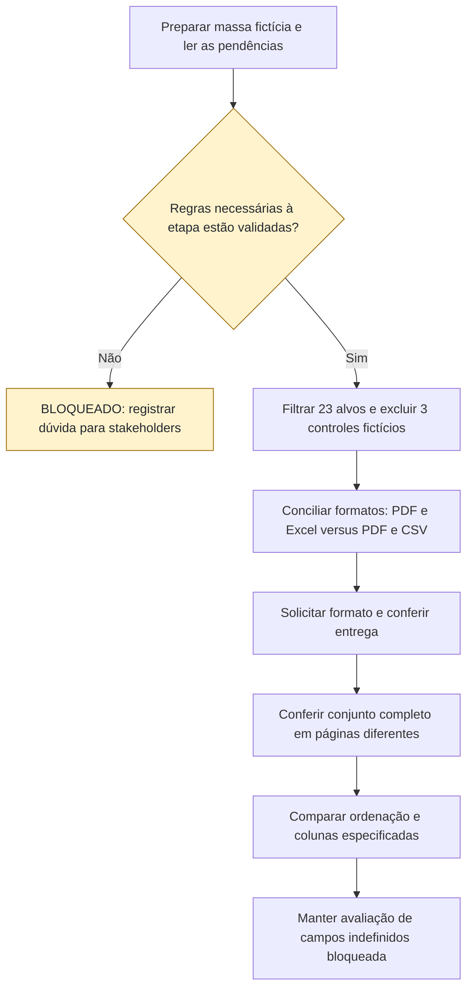

# UCS005 — Exportar consulta filtrada de inversores em todos os formatos

[Índice de fluxos](../fluxos.md) · [README](../../README.md) · [Cenário original](../../functional_tests/ativos/inversores/UCS005_exportacao_1.py)

O diagrama resume o fluxo principal e as variantes indicadas. Antes de cada etapa, conferir seus bloqueios; o ramo “Sim” é condicional e não declara que já houve validação. Os fluxos alternativos e os resultados completos estão descritos abaixo.

## Fluxo visual

## Especificação completa

Autoria / responsável acadêmico: Diogo Bruno Ferreira Martins de Aguiar
Preparação assistida por IA; revisão humana e apresentação pendentes.
Revisão documental: 06/11/2026. Criação: 05/11/2026. Revisão-base: 5f3072939bb7ce5f90b64bf0faa5483bbb0d3260
Natureza: cenário documental; não é teste automatizado; não executado.

### OBJETIVO

Conferir formatos obrigatórios, filtros, abrangência além da página e ordem do arquivo coletivo.
É um fluxo de relatório, sem operações CRUD divididas para aumentar a contagem.

### REQUISITOS RELACIONADOS

Grupo: Gestão de Inversores.
Feature #35875 — Exportação de inversores. Relacionadas: Consulta #24249 e US #24457.
Tópicos da consolidação local (mapeamento revisado em docs/matriz-rastreabilidade.md): Formatos de exportação; Resultado completo da consulta; Filtros da exportação; Dados do arquivo; Entrega do arquivo; Ordenação.

### SITUAÇÃO DAS REGRAS E BLOQUEIOS

FP2 e A1: CONFLITO — CA #24449, em Consulta #24249, exige PDF e Excel; CA01 da nova Feature #35875 descreve PDF e CSV. Confirmar se Excel permanece exigido; CSV não é Excel e a nova descrição não comprova revogação do requisito original. FP3 a FP6: abrangência de todas as páginas, colunas CSV, entrega e ordenação constam dos acréscimos da exportação e aguardam validação. Filtros adicionais ao CA #24447 também precisam de validação. A autorização específica para exportar continua indefinida.
Resultados de acréscimos a validar são expectativas propostas. Não aprovar essas etapas antes da decisão registrada dos stakeholders. IDs globais e rótulos locais são distinguidos em docs/matriz-rastreabilidade.md.

### ATOR

Pessoa usuária cuja autorização para a modalidade deverá ser definida pelos stakeholders.
A matriz de perfis e permissões permanece pendente; não inferir autorização de exportação pelo acesso à consulta.

### PRÉ-CONDIÇÕES

Ambiente futuro isolado e massa sintética já preparada. Nenhuma criação de cadastro
ocorre neste cenário de exportação. Na execução futura, preservar os controles.
As definições pendentes são resolvidas antes de aprovar a etapa dependente.

### DADOS DE TESTE

23 registros fictícios ESTUDO-INVERSORES-01 a 23 que correspondem ao filtro
e três CONTROLE-01 a 03 que não correspondem. Página de dez registros, se disponível.
O número 23 é massa que atravessa páginas, não limite de produto. Filtros previstos:
O conjunto exportado deve respeitar busca por série, modelo, fabricante, fornecedor, usina, operadora, situação e demais filtros definidos na consulta. Registros que não atendam aos filtros não devem ser acrescentados ao relatório.
Todos os dados são fictícios; não constituem limites ou regras novas.

### [FP] FLUXO PRINCIPAL

1. Acessar a consulta e aplicar um filtro previsto que selecione os 23 alvos,
   excluindo os três controles. Conferir o total antes de exportar.
2. Escolher uma ordenação suportada e solicitar cada formato obrigatório, um por vez.
   CONFLITO PENDENTE: #24449 exige PDF e Excel, enquanto CA01 de #35875 especifica PDF e CSV. A avaliação final de formatos fica BLOQUEADA até conciliar as fontes; registrar as duas exigências sem substituir Excel por CSV. Cada arquivo entregue deve corresponder ao formato solicitado. A exportação de um registro individual é em PDF.
3. Verificar o início do download e a informação do resultado de obtenção.
4. Comparar identidades: os 23 alvos devem estar no arquivo, nenhum dos três controles.
   Repetir a solicitação em outra página: o conjunto continua completo.
5. Comparar a sequência com a ordenação da consulta, prevista para este grupo.
6. Se CSV estiver previsto/disponível, conferir as colunas definidas e respectivos
   valores: O arquivo CSV deve apresentar: Número de Série, Potência, Modelo, Fabricante, Fornecedor, Usina, Posse, Situação, Garantia de Compra e Garantia de Instalação. A verificação deve comparar os valores com os registros selecionados; campos ausentes na especificação original ou diferenças entre formatos permanecem nas pendências, sem presumir equivalência.
7. Não aprovar conteúdo completo de PDF/Excel sem a definição ainda pendente.
   Aprovação de conjunto/ordem não equivale à aprovação de todas as colunas.

### [A] FLUXOS ALTERNATIVOS

1. Formatos divergentes entre as fontes: registrar conflito e solicitar decisão antes do aceite global; CSV não substitui Excel. Não declarar o conflito resolvido pela implementação.
2. Consulta vazia: comportamento pendente; não presumir arquivo vazio ou ausência de download.

### REGRAS DE NEGÓCIO

Cada resultado proposto está sujeito à situação da regra indicada acima. Formato, conjunto, identidade e
entrega são verificações distintas. A implementação não define o resultado esperado.
Não definir mensagens literais, prazos, novas tentativas ou campos não especificados.

### RESULTADOS ESPERADOS

Os resultados aparecem junto a cada ação para permitir comparação passo a passo.
Nenhum arquivo foi gerado ou cenário executado. Em futura execução registrar
versão, data, massa, esperado, observado e evidência, sem declarar sucesso antecipado.

### PENDÊNCIAS

Consultar também SITUAÇÃO DAS REGRAS E BLOQUEIOS acima.
Campos completos de PDF coletivo e individual, unidades e apresentação de dados ausentes precisam de decisão. O conteúdo CSV descrito não autoriza presumir igualdade dos demais formatos. Definir consulta vazia, fotografia temporal do inventário e recuperação após perda de resposta.
