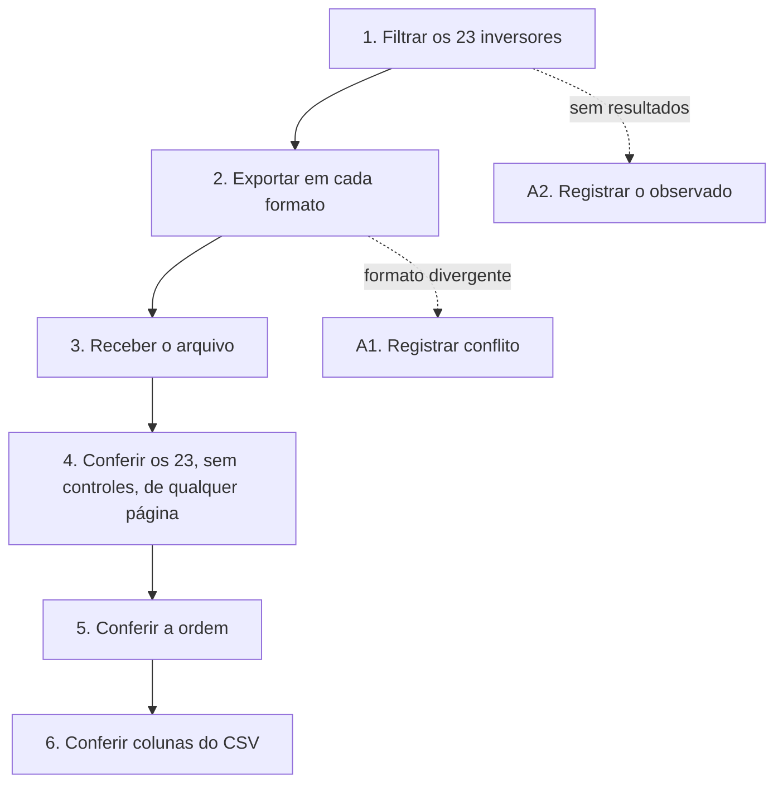

# UCS005 — Exportar consulta filtrada de inversores em todos os formatos

[Índice de fluxos](../fluxos.md) · [README](../../README.md) · [Cenário no formato do professor (.py)](../../functional_tests/ativos/inversores/UCS005_exportacao_1.py) · [Pendências](../pendencias.md#ucs005)

## Objetivo

Verificar que a exportação coletiva traz todos os inversores do filtro, em cada formato obrigatório e na ordem da consulta, mesmo quando o resultado ocupa várias páginas.

## Requisitos

- Feature #35875 — Exportação de inversores. Relacionadas: Consulta #24249 e US #24457.
- Tópicos da consolidação: formatos de exportação, resultado completo da consulta, filtros, dados do arquivo, entrega do arquivo e ordenação.

## Ator

Administrador. O critério Autorização da Feature exige apenas autorização para consultar a listagem (exportação coletiva); o cenário usa o Administrador, que tem essa autorização. A recusa sem autorização é verificada no UCS007.

## Pré-condições

- Ambiente de teste isolado, com a massa abaixo já cadastrada.

## Dados de teste

- 23 inversores fictícios ESTUDO-INVERSORES-01 a 23 que atendem ao filtro.
- 3 inversores CONTROLE-01 a 03 que não atendem.
- Consulta com páginas de 10 registros, para o resultado ocupar três páginas.
- Filtros disponíveis: série, modelo, fabricante, fornecedor, usina, operadora e situação.

## Fluxo principal

1. **Filtrar.** Aplicar um filtro que selecione os 23 inversores de estudo. **Esperado:** total de 23, sem os controles.
2. **Exportar em cada formato.** Escolher uma ordenação e solicitar cada formato obrigatório, um por vez. **Esperado:** cada arquivo no formato pedido. Os formatos estão em conflito entre as fontes (ver RN1 em Regras de negócio).
3. **Receber o arquivo.** **Esperado:** download iniciado e resultado informado.
4. **Conferir o conjunto.** **Esperado:** os 23 inversores estão no arquivo e nenhum controle. Repetir a exportação a partir de outra página: o conjunto continua completo.
5. **Conferir a ordem.** **Esperado:** mesma ordem da consulta.
6. **Conferir o CSV.** **Esperado:** colunas Número de Série, Potência, Modelo, Fabricante, Fornecedor, Usina, Posse, Situação, Garantia de Compra e Garantia de Instalação, com os valores dos registros.

## Fluxos alternativos

- **A1. Formatos divergentes.** Se o sistema oferecer formatos diferentes dos exigidos por uma das fontes, registrar o conflito; CSV não substitui Excel.
- **A2. Consulta vazia.** Exportar um filtro sem resultados e registrar o comportamento observado (ainda não definido).

## Regras de negócio

- **RN1.** O CA #24449 exige PDF e Excel; o CA01 da Feature #35875 descreve PDF e CSV. A avaliação dos formatos fica bloqueada até a decisão.
- A exportação contém todos os registros do filtro, e não só os da página exibida.
- O arquivo segue a ordenação da consulta.
- O conteúdo do PDF e do Excel ainda não está definido. A ficha individual é tratada no UCS006.

## Diagrama

## Pendências

Conflito PDF/Excel × PDF/CSV, conteúdo do PDF e comportamento com consulta vazia. Detalhes em [pendências do UCS005](../pendencias.md#ucs005).
