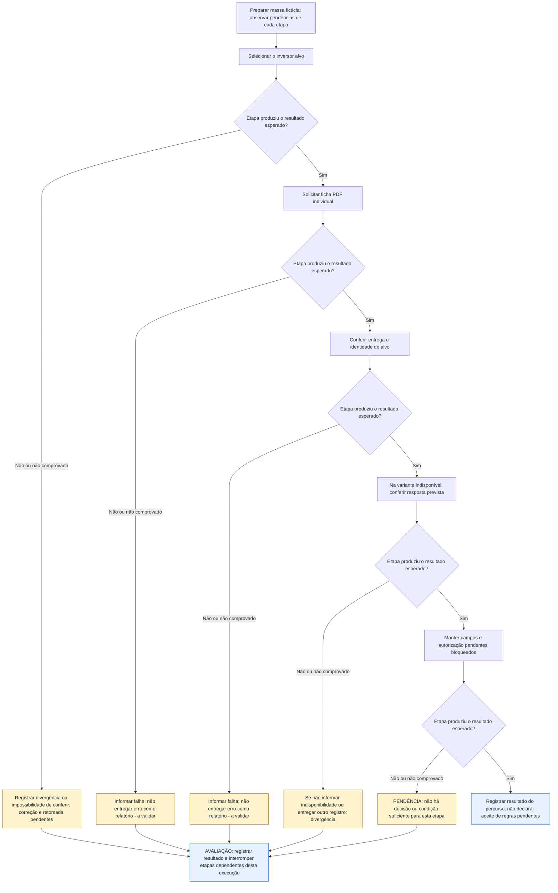

# UCS006 — Exportar ficha individual de inversores

[Índice de fluxos](../fluxos.md) · [README](../../README.md) · [Cenário original](../../functional_tests/ativos/inversores/UCS006_exportacao_2.py)

Os losangos representam a avaliação da etapa no cenário, não novos controles da interface. **Falha esperada e corretamente tratada pode atender ao cenário negativo.** Uma falha inesperada interrompe apenas as etapas dependentes desta execução. Essa interrupção é uma orientação de teste, não uma regra do sistema. Não há repetição automática, rollback, preservação de campos ou retomada presumidos. Os acréscimos marcados **a validar** continuam sujeitos ao aceite dos stakeholders.

## Fluxo visual

## Falhas, recusas e pendências por etapa

As referências CAxx abaixo são rótulos dentro da Feature indicada, não IDs globais novos. Uma mensagem de falha não comprova que nenhuma gravação ocorreu; em perda de resposta, o estado final permanece a verificar.

| Etapa ou variante | Resposta prevista ou pendência | Base |
| --- | --- | --- |
| 1. Selecionar o inversor alvo | Registrar divergência ou impossibilidade de conferir; correção e retomada pendentes. Não continuar etapas dependentes. | Resultados esperados do cenário; não há resposta automática definida para divergência constatada pelo avaliador |
| 2. Solicitar ficha PDF individual | Informar falha; não entregar erro como relatório - a validar. Não continuar etapas dependentes. | #35875 CA06, acréscimo a validar |
| 3. Conferir entrega e identidade do alvo | Informar falha; não entregar erro como relatório - a validar. Não continuar etapas dependentes. | #35875 CA06, acréscimo a validar |
| 4. Na variante indisponível, conferir resposta prevista | Se não informar indisponibilidade ou entregar outro registro: divergência. Não continuar etapas dependentes. | #35875 CA04, a validar |
| 5. Manter campos e autorização pendentes bloqueados | PENDÊNCIA: não há decisão ou condição suficiente para esta etapa. Não continuar etapas dependentes. | Pendências do próprio cenário; não é falha comprovada do sistema |

## Especificação completa

Autoria / responsável acadêmico: Diogo Bruno Ferreira Martins de Aguiar
Preparação assistida por IA; revisão humana e apresentação pendentes.
Revisão documental: 06/11/2026. Criação: 05/11/2026. Revisão-base: 5f3072939bb7ce5f90b64bf0faa5483bbb0d3260
Natureza: cenário documental; não é teste automatizado; não executado.

### OBJETIVO

Conferir a identidade da ficha individual e a resposta quando o alvo está indisponível.
É um fluxo de relatório, sem operações CRUD divididas para aumentar a contagem.

### REQUISITOS RELACIONADOS

Grupo: Gestão de Inversores.
Feature #35875 — Exportação de inversores. Relacionadas: Consulta #24249 e US #24457.
Tópicos da consolidação local (mapeamento revisado em docs/matriz-rastreabilidade.md): Arquivo individual; Registro individual indisponível; Entrega do arquivo.

### SITUAÇÃO DAS REGRAS E BLOQUEIOS

FP1 a FP5: PDF individual, identidade do registro, indisponibilidade e entrega constam dos acréscimos da Feature #35875, sem comprovação de validação dos stakeholders. Confirmar autorização da modalidade e campos completos do PDF. O conflito PDF/Excel versus PDF/CSV refere-se à exportação coletiva (UCS005); não resolve o contrato da ficha individual.
Resultados de acréscimos a validar são expectativas propostas. Não aprovar essas etapas antes da decisão registrada dos stakeholders. IDs globais e rótulos locais são distinguidos em docs/matriz-rastreabilidade.md.

### ATOR

Pessoa usuária cuja autorização para a modalidade deverá ser definida pelos stakeholders.
A matriz de perfis e permissões permanece pendente; não inferir autorização de exportação pelo acesso à consulta.

### PRÉ-CONDIÇÕES

Ambiente futuro isolado e massa sintética já preparada. Nenhuma criação de cadastro
ocorre neste cenário de exportação. Na execução futura, preservar os controles.
As definições pendentes são resolvidas antes de aprovar a etapa dependente.

### DADOS DE TESTE

Um registro fictício ESTUDO-INVERSORES-01 e outro CONTROLE-01.
Para inversores, nenhuma suposição sobre campos completos do PDF é adicionada.
Todos os dados são fictícios; não constituem limites ou regras novas.

### [FP] FLUXO PRINCIPAL

1. Selecionar ESTUDO-INVERSORES-01 na consulta e solicitar sua ficha PDF.
2. Verificar início de download e informação do resultado.
3. Abrir o documento em futura execução e conferir a identidade do alvo, distinguindo-a
   de CONTROLE-01. Não aceitar PDF coletivo como substituto da ficha.
4. Registrar como pendente o conjunto completo de campos da ficha; não derivar esse conjunto das colunas CSV.
5. Na variante com alvo previamente indisponível, repetir a solicitação. Esperado:
   informar indisponibilidade; não entregar ficha de outro registro.

### [A] FLUXOS ALTERNATIVOS

1. Alvo diferente no PDF: resultado divergente; conferir identificação, não apenas existência do arquivo.
2. Campos de PDF não definidos: marcar avaliação desses campos BLOQUEADA, mesmo com identidade correta.

### REGRAS DE NEGÓCIO

Cada resultado proposto está sujeito à situação da regra indicada acima. Formato, conjunto, identidade e
entrega são verificações distintas. A implementação não define o resultado esperado.
Não definir mensagens literais, prazos, novas tentativas ou campos não especificados.

### RESULTADOS ESPERADOS

Os resultados aparecem junto a cada ação para permitir comparação passo a passo.
Nenhum arquivo foi gerado ou cenário executado. Em futura execução registrar
versão, data, massa, esperado, observado e evidência, sem declarar sucesso antecipado.

### PENDÊNCIAS

Consultar também SITUAÇÃO DAS REGRAS E BLOQUEIOS acima.
Campos completos de PDF coletivo e individual, unidades e apresentação de dados ausentes precisam de decisão. O conteúdo CSV descrito não autoriza presumir igualdade dos demais formatos. Definir consulta vazia, fotografia temporal do inventário e recuperação após perda de resposta.
