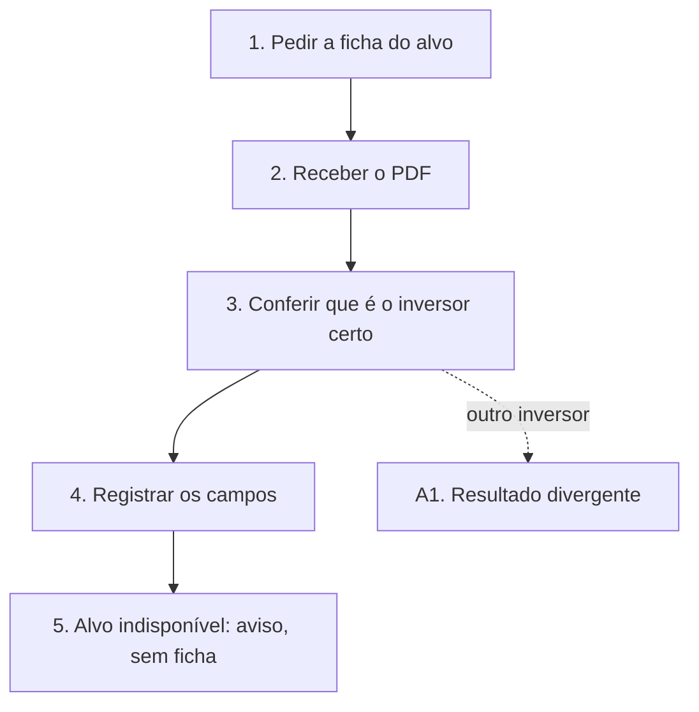

# UCS006 — Exportar ficha individual de inversores

[Índice de fluxos](../fluxos.md) · [README](../../README.md) · [Cenário no formato do professor (.py)](../../functional_tests/ativos/inversores/UCS006_exportacao_2.py) · [Pendências](../pendencias.md#ucs006)

## Objetivo

Verificar que a ficha em PDF corresponde ao inversor escolhido e que um inversor indisponível gera aviso, e não a ficha de outro registro.

## Requisitos

- Feature #35875 — Exportação de inversores. Relacionadas: Consulta #24249 e US #24457.
- Tópicos da consolidação: arquivo individual, registro individual indisponível e entrega do arquivo.

## Ator

Administrador. O critério Autorização da Feature exige apenas autorização para visualizar o registro (exportação individual); o cenário usa o Administrador, que tem essa autorização. A recusa sem autorização é verificada no UCS007.

## Pré-condições

- Ambiente de teste isolado, com a massa abaixo já cadastrada.

## Dados de teste

- Inversor fictício ESTUDO-INVERSORES-01 (alvo).
- Inversor CONTROLE-01, que não pode aparecer na ficha do alvo.

## Fluxo principal

1. **Solicitar a ficha.** Selecionar ESTUDO-INVERSORES-01 na consulta e pedir a ficha em PDF.
2. **Receber o arquivo.** **Esperado:** download iniciado e resultado informado.
3. **Conferir a identidade.** **Esperado:** o PDF identifica ESTUDO-INVERSORES-01, e não CONTROLE-01. Um PDF coletivo não vale como ficha.
4. **Conferir os campos.** Os campos completos da ficha ainda não estão definidos; registrar o que aparece, sem usar as colunas do CSV como referência.
5. **Inversor indisponível.** Repetir a solicitação com um alvo que deixou de estar disponível. **Esperado:** indisponibilidade informada, sem entregar a ficha de outro registro.

## Fluxos alternativos

- **A1. Inversor diferente no PDF.** Se o PDF identificar outro inversor, o resultado é divergente, mesmo que o arquivo exista.

## Regras de negócio

- A ficha individual é um PDF do registro selecionado.
- Os campos completos da ficha ainda não estão definidos; até lá, a avaliação desses campos fica bloqueada.

## Diagrama

## Pendências

Campos completos da ficha em PDF. Detalhes em [pendências do UCS006](../pendencias.md#ucs006).
