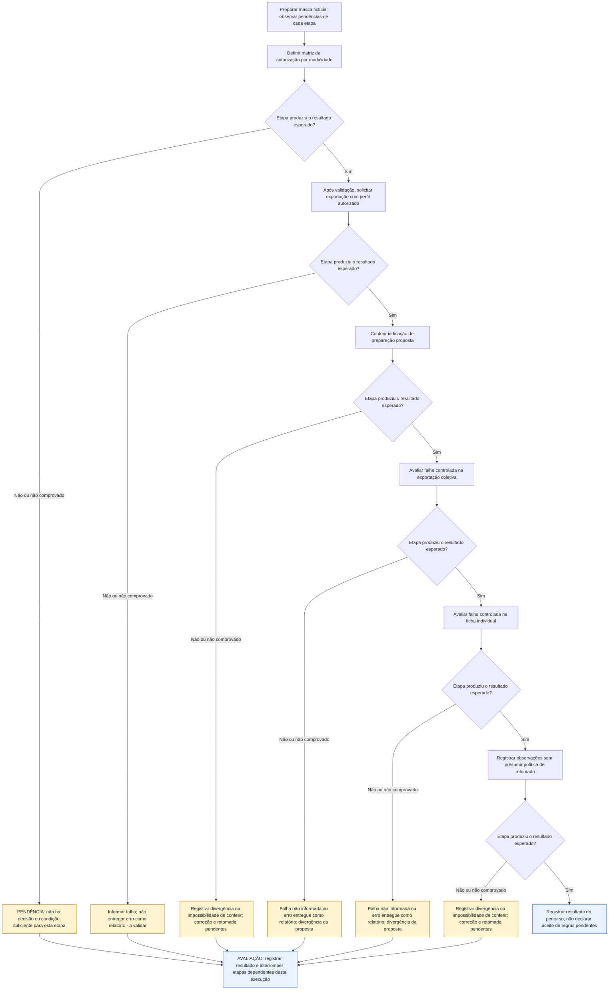

# UCS007 — Tratar autorização e falha de exportação de inversores

[Índice de fluxos](../fluxos.md) · [README](../../README.md) · [Cenário original](../../functional_tests/ativos/inversores/UCS007_exportacao_3.py)

Os losangos representam a avaliação da etapa no cenário, não novos controles da interface. **Falha esperada e corretamente tratada pode atender ao cenário negativo.** Uma falha inesperada interrompe apenas as etapas dependentes desta execução. Essa interrupção é uma orientação de teste, não uma regra do sistema. Não há repetição automática, rollback, preservação de campos ou retomada presumidos. Os acréscimos marcados **a validar** continuam sujeitos ao aceite dos stakeholders.

## Fluxo visual

## Falhas, recusas e pendências por etapa

As referências CAxx abaixo são rótulos dentro da Feature indicada, não IDs globais novos. Uma mensagem de falha não comprova que nenhuma gravação ocorreu; em perda de resposta, o estado final permanece a verificar.

| Etapa ou variante | Resposta prevista ou pendência | Base |
| --- | --- | --- |
| 1. Definir matriz de autorização por modalidade | PENDÊNCIA: não há decisão ou condição suficiente para esta etapa. Não continuar etapas dependentes. | Pendências do próprio cenário; não é falha comprovada do sistema |
| 2. Após validação, solicitar exportação com perfil autorizado | Informar falha; não entregar erro como relatório - a validar. Não continuar etapas dependentes. | #35875 CA06, acréscimo a validar |
| 3. Conferir indicação de preparação proposta | Registrar divergência ou impossibilidade de conferir; correção e retomada pendentes. Não continuar etapas dependentes. | Resultados esperados do cenário; não há resposta automática definida para divergência constatada pelo avaliador |
| 4. Avaliar falha controlada na exportação coletiva | Falha não informada ou erro entregue como relatório: divergência da proposta. Não continuar etapas dependentes. | #35875 CA06, a validar |
| 5. Avaliar falha controlada na ficha individual | Falha não informada ou erro entregue como relatório: divergência da proposta. Não continuar etapas dependentes. | #35875 CA06, a validar |
| 6. Registrar observações sem presumir política de retomada | Registrar divergência ou impossibilidade de conferir; correção e retomada pendentes. Não continuar etapas dependentes. | Resultados esperados do cenário; não há resposta automática definida para divergência constatada pelo avaliador |

## Especificação completa

Autoria / responsável acadêmico: Diogo Bruno Ferreira Martins de Aguiar
Preparação assistida por IA; revisão humana e apresentação pendentes.
Revisão documental: 06/11/2026. Criação: 05/11/2026. Revisão-base: 5f3072939bb7ce5f90b64bf0faa5483bbb0d3260
Natureza: cenário documental; não é teste automatizado; não executado.

### OBJETIVO

Conferir recusa por autorização, estado de andamento e resposta de falha sem entregar erro como relatório.
É um fluxo de relatório, sem operações CRUD divididas para aumentar a contagem.

### REQUISITOS RELACIONADOS

Grupo: Gestão de Inversores.
Feature #35875 — Exportação de inversores. Relacionadas: Consulta #24249 e US #24457.
Tópicos da consolidação local (mapeamento revisado em docs/matriz-rastreabilidade.md): Autorização; Falha na obtenção do arquivo; Exportação em andamento.

### SITUAÇÃO DAS REGRAS E BLOQUEIOS

FP1 e A1: BLOQUEADOS até aprovação da matriz de autorização por modalidade. Ausência de consulta ou visualização não define sozinha a recusa da exportação. FP2 a FP4: andamento e falha constam dos novos CA05/CA06 da Feature #35875; expectativas propostas, pendentes de validação. FP5: retomada e tentativas continuam sem definição.
Resultados de acréscimos a validar são expectativas propostas. Não aprovar essas etapas antes da decisão registrada dos stakeholders. IDs globais e rótulos locais são distinguidos em docs/matriz-rastreabilidade.md.

### ATOR

Pessoa usuária cuja autorização para a modalidade deverá ser definida pelos stakeholders.
A matriz de perfis e permissões permanece pendente; não inferir autorização de exportação pelo acesso à consulta.

### PRÉ-CONDIÇÕES

Ambiente futuro isolado e massa sintética já preparada. Nenhuma criação de cadastro
ocorre neste cenário de exportação. Na execução futura, preservar os controles.
As definições pendentes são resolvidas antes de aprovar a etapa dependente.

### DADOS DE TESTE

Perfis sintéticos propostos para discussão: A com consulta e visualização; B sem consulta; C sem visualização. Nenhum tem autorização de exportação presumida.
Alvo ESTUDO-INVERSORES-01 existente e consulta filtrada com dados fictícios.
Os perfis representam permissões para esta análise, não novos papéis do produto.
Uma condição controlada de falha de obtenção deve ser preparada para futura execução.
Todos os dados são fictícios; não constituem limites ou regras novas.

### [FP] FLUXO PRINCIPAL

1. BLOQUEADO: submeter os perfis A, B e C à definição da matriz de exportação
   coletiva e individual. Registrar quem poderá exportar em cada modalidade e
   o resultado previsto para acesso não autorizado; não presumir recusa a B/C.
2. Após definir um perfil autorizado, solicitar exportação coletiva. Durante preparação, verificar
   indicação de andamento e controle da ação indisponível para novo acionamento.
3. Preparar a variante de falha controlada de obtenção e solicitar exportação.
   Esperado: falha informada; conteúdo de erro não é entregue como relatório.
4. Repetir a variante de falha para a ficha individual, mantendo alvo existente.
   Esperado: falha informada; nenhum relatório de erro apresentado como ficha.
5. Registrar o que foi possível observar; retorno do controle, número de tentativas
   e retomada após resposta desconhecida permanecem sem contrato aprovado.

### [A] FLUXOS ALTERNATIVOS

1. BLOQUEADO: confirmar se as modalidades têm autorizações independentes e sua relação com consulta/visualização. Somente depois definir os resultados das combinações.
2. Perda de resposta ou concorrência: resultado pendente; não presumir repetição automática nem reutilização do arquivo.

### REGRAS DE NEGÓCIO

Cada resultado proposto está sujeito à situação da regra indicada acima. Formato, conjunto, identidade e
entrega são verificações distintas. A implementação não define o resultado esperado.
Não definir mensagens literais, prazos, novas tentativas ou campos não especificados.

### RESULTADOS ESPERADOS

Os resultados aparecem junto a cada ação para permitir comparação passo a passo.
Nenhum arquivo foi gerado ou cenário executado. Em futura execução registrar
versão, data, massa, esperado, observado e evidência, sem declarar sucesso antecipado.

### PENDÊNCIAS

Consultar também SITUAÇÃO DAS REGRAS E BLOQUEIOS acima.
Campos completos de PDF coletivo e individual, unidades e apresentação de dados ausentes precisam de decisão. O conteúdo CSV descrito não autoriza presumir igualdade dos demais formatos. Definir consulta vazia, fotografia temporal do inventário e recuperação após perda de resposta.
