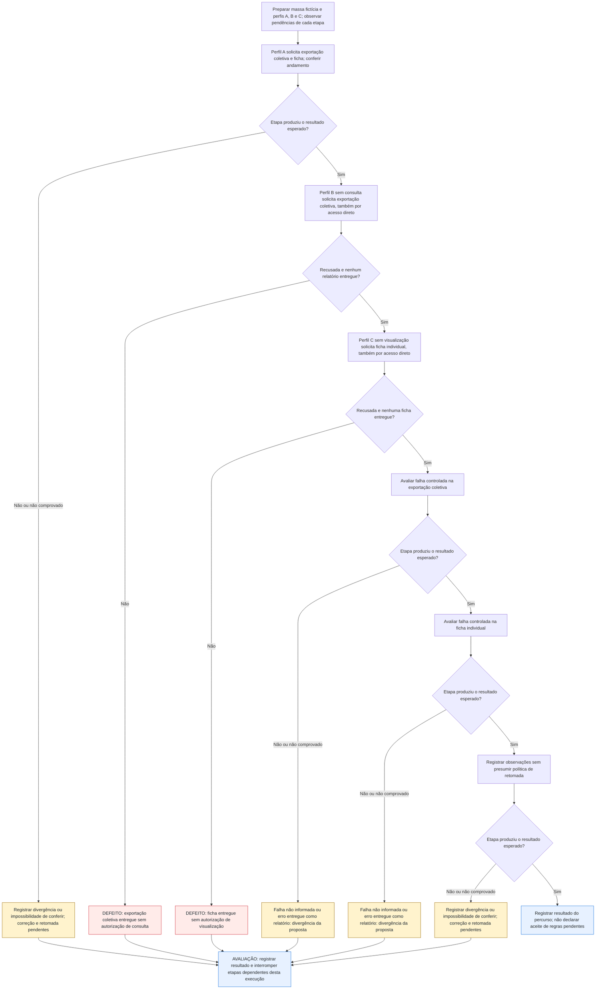

# UCS007 — Tratar autorização e falha de exportação de inversores

[Índice de fluxos](../fluxos.md) · [README](../../README.md) · [Cenário original](../../functional_tests/ativos/inversores/UCS007_exportacao_3.py)

Os losangos representam a avaliação da etapa no cenário, não novos controles da interface. **Falha esperada e corretamente tratada pode atender ao cenário negativo.** Uma falha inesperada interrompe apenas as etapas dependentes desta execução. Essa interrupção é uma orientação de teste, não uma regra do sistema. Não há repetição automática, rollback, preservação de campos ou retomada presumidos. Os acréscimos marcados **a validar** continuam sujeitos ao aceite dos stakeholders.

## Fluxo visual

## Falhas, recusas e pendências por etapa

As referências CAxx abaixo são rótulos dentro da Feature indicada, não IDs globais novos. Uma mensagem de falha não comprova que nenhuma gravação ocorreu; em perda de resposta, o estado final permanece a verificar.

| Etapa ou variante | Resposta prevista ou pendência | Base |
| --- | --- | --- |
| 1. Perfil A solicita exportação coletiva e ficha; conferir andamento | Registrar divergência ou impossibilidade de conferir; correção e retomada pendentes. Não continuar etapas dependentes. | #35875 CA05, acréscimo a validar |
| 2. Perfil B sem consulta solicita exportação coletiva | Exportação recusada e nenhum relatório entregue. Arquivo entregue é defeito de controle de acesso. | Critério Autorização da Feature; US #24457, cenário "Usuário sem autorização" |
| 3. Perfil C sem visualização solicita ficha individual | Exportação recusada e nenhuma ficha entregue. Arquivo entregue é defeito de controle de acesso. | Critério Autorização da Feature; US #24457; CA #24439 (CA-2.1.1.2.01) na ficha individual |
| 4. Avaliar falha controlada na exportação coletiva | Falha não informada ou erro entregue como relatório: divergência da proposta. Não continuar etapas dependentes. | #35875 CA06, a validar |
| 5. Avaliar falha controlada na ficha individual | Falha não informada ou erro entregue como relatório: divergência da proposta. Não continuar etapas dependentes. | #35875 CA06, a validar |
| 6. Registrar observações sem presumir política de retomada | Registrar divergência ou impossibilidade de conferir; correção e retomada pendentes. Não continuar etapas dependentes. | Resultados esperados do cenário; não há resposta automática definida para divergência constatada pelo avaliador |

## Especificação completa

Autoria / responsável acadêmico: Diogo Bruno Ferreira Martins de Aguiar
Preparação assistida por IA; revisão humana e apresentação pendentes.
Revisão documental: 06/11/2026. Criação: 05/11/2026. Revisão-base: 5f3072939bb7ce5f90b64bf0faa5483bbb0d3260
Natureza: cenário documental; não é teste automatizado; não executado.

### OBJETIVO

Conferir recusa por autorização em cada modalidade, estado de andamento e resposta de falha sem entregar erro como relatório.
É um fluxo de relatório, sem operações CRUD divididas para aumentar a contagem.

### REQUISITOS RELACIONADOS

Grupo: Gestão de Inversores.
Feature #35875 — Exportação de inversores. Relacionadas: Consulta #24249 e US #24457.
Tópicos da consolidação local (mapeamento revisado em docs/matriz-rastreabilidade.md): Autorização; Falha na obtenção do arquivo; Exportação em andamento.
Critério Autorização (CA consolidado da Feature): a exportação coletiva exige autorização para consultar
a listagem; a exportação individual exige autorização para visualizar o registro; uma solicitação sem a
autorização correspondente deve ser recusada.
Para inversores, a exigência de autorização de visualização para a exportação individual também
consta do CA original #24439 (CA-2.1.1.2.01).

### SITUAÇÃO DAS REGRAS E BLOQUEIOS

FP2 e FP3: a recusa vem do critério Autorização do CA consolidado da Feature e do cenário
"Usuário sem autorização" da US de origem #24457: exportação recusada e nenhum relatório entregue.
Esse critério ainda não aparece entre os CA01–CA07 publicados na Feature #35875; registrá-lo na publicação é pendência de registro, não de definição da regra.
FP1, FP4 e FP5: andamento e falha constam dos novos CA05/CA06 da Feature #35875; expectativas propostas, pendentes de validação. FP6: retomada e tentativas continuam sem definição.
Resultados de acréscimos a validar são expectativas propostas. Não aprovar essas etapas antes da decisão registrada dos stakeholders. IDs globais e rótulos locais são distinguidos em docs/matriz-rastreabilidade.md.

### ATOR

Perfis sintéticos para esta análise, não novos papéis do produto:
- Perfil A: autorização para consultar a listagem e para visualizar o registro.
- Perfil B: sem autorização para consultar a listagem.
- Perfil C: autorização para consultar a listagem, sem autorização para visualizar o registro.

### PRÉ-CONDIÇÕES

Ambiente futuro isolado e massa sintética já preparada. Nenhuma criação de cadastro
ocorre neste cenário de exportação. Na execução futura, preservar os controles.
As definições pendentes são resolvidas antes de aprovar a etapa dependente.

### DADOS DE TESTE

Alvo ESTUDO-INVERSORES-01 existente e consulta filtrada com dados fictícios.
Uma condição controlada de falha de obtenção deve ser preparada para futura execução.
Todos os dados são fictícios; não constituem limites ou regras novas.

### [FP] FLUXO PRINCIPAL

1. CONTROLE. Com o Perfil A, solicitar a exportação coletiva e a ficha individual de ESTUDO-INVERSORES-01;
   anotar o endereço e a solicitação usados. Durante a preparação, verificar indicação de
   andamento e controle da ação indisponível para novo acionamento.
2. SEM CONSULTA. Com o Perfil B, solicitar a exportação coletiva, inclusive diretamente pelo
   endereço anotado no passo 1, sem usar os controles da tela.
   Esperado: exportação recusada e nenhum relatório entregue.
3. SEM VISUALIZAÇÃO. Com o Perfil C, solicitar a ficha individual de ESTUDO-INVERSORES-01, inclusive
   diretamente pelo endereço anotado no passo 1.
   Esperado: exportação recusada e nenhuma ficha entregue.
4. Preparar a variante de falha controlada de obtenção e, com o Perfil A, solicitar exportação.
   Esperado: falha informada; conteúdo de erro não é entregue como relatório.
5. Repetir a variante de falha para a ficha individual, mantendo alvo existente.
   Esperado: falha informada; nenhum relatório de erro apresentado como ficha.
6. Registrar o que foi possível observar; retorno do controle, número de tentativas
   e retomada após resposta desconhecida permanecem sem contrato aprovado.

### [A] FLUXOS ALTERNATIVOS

1. Pela interface. Registrar se as opções de exportação aparecem para os Perfis B e C. Os critérios não
   determinam ocultar a opção; ocultá-la não substitui a recusa verificada nos passos 2 e 3.
2. Perda de resposta ou concorrência: resultado pendente; não presumir repetição automática nem reutilização do arquivo.

### REGRAS DE NEGÓCIO

Cada modalidade exige sua própria autorização: consultar a listagem não autoriza a ficha individual
sem a autorização de visualização. Formato, conjunto, identidade e entrega são verificações distintas.
A implementação não define o resultado esperado.
Não definir mensagens literais, códigos de resposta, prazos, novas tentativas ou campos não especificados.

### RESULTADOS ESPERADOS

Os resultados aparecem junto a cada ação para permitir comparação passo a passo.
Qualquer arquivo entregue nos passos 2 e 3 é defeito de controle de acesso.
Nenhum arquivo foi gerado ou cenário executado. Em futura execução registrar
versão, data, perfil, massa, esperado, observado e evidência, sem declarar sucesso antecipado.

### PENDÊNCIAS

Consultar também SITUAÇÃO DAS REGRAS E BLOQUEIOS acima.
Forma de apresentar a recusa. Campos completos de PDF coletivo e individual, unidades e apresentação de dados ausentes precisam de decisão. O conteúdo CSV descrito não autoriza presumir igualdade dos demais formatos. Definir consulta vazia, fotografia temporal do inventário e recuperação após perda de resposta.
