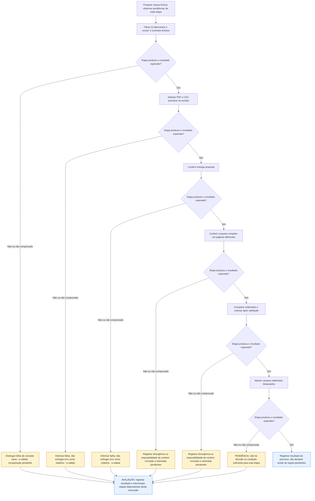

# UCS008 — Exportar consulta filtrada de fabricantes em todos os formatos

[Índice de fluxos](../fluxos.md) · [README](../../README.md) · [Cenário original](../../functional_tests/ativos/marcas/UCS008_exportacao_1.py)

Os losangos representam a avaliação da etapa no cenário, não novos controles da interface. **Falha esperada e corretamente tratada pode atender ao cenário negativo.** Uma falha inesperada interrompe apenas as etapas dependentes desta execução. Essa interrupção é uma orientação de teste, não uma regra do sistema. Não há repetição automática, rollback, preservação de campos ou retomada presumidos. Os acréscimos marcados **a validar** continuam sujeitos ao aceite dos stakeholders.

## Fluxo visual

## Falhas, recusas e pendências por etapa

As referências CAxx abaixo são rótulos dentro da Feature indicada, não IDs globais novos. Uma mensagem de falha não comprova que nenhuma gravação ocorreu; em perda de resposta, o estado final permanece a verificar.

| Etapa ou variante | Resposta prevista ou pendência | Base |
| --- | --- | --- |
| 1. Filtrar 23 fabricantes e excluir 3 controles fictícios | Distinguir falha de consulta vazia - a validar; recuperação pendente. Não continuar etapas dependentes. | #24273 CA13, acréscimo a validar; recuperação não definida |
| 2. Solicitar PDF e CSV previstos na revisão | Informar falha; não entregar erro como relatório - a validar. Não continuar etapas dependentes. | #35912 CA01, acréscimo a validar |
| 3. Conferir entrega proposta | Informar falha; não entregar erro como relatório - a validar. Não continuar etapas dependentes. | #35912 CA01, acréscimo a validar |
| 4. Conferir conjunto completo em páginas diferentes | Registrar divergência ou impossibilidade de conferir; correção e retomada pendentes. Não continuar etapas dependentes. | Resultados esperados do cenário; não há resposta automática definida para divergência constatada pelo avaliador |
| 5. Comparar ordenação e colunas após validação | Registrar divergência ou impossibilidade de conferir; correção e retomada pendentes. Não continuar etapas dependentes. | Resultados esperados do cenário; não há resposta automática definida para divergência constatada pelo avaliador |
| 6. Manter campos indefinidos bloqueados | PENDÊNCIA: não há decisão ou condição suficiente para esta etapa. Não continuar etapas dependentes. | Pendências do próprio cenário; não é falha comprovada do sistema |

## Especificação completa

Autoria / responsável acadêmico: Diogo Bruno Ferreira Martins de Aguiar
Preparação assistida por IA; revisão humana e apresentação pendentes.
Revisão documental: 06/11/2026. Criação: 05/11/2026. Revisão-base: 5f3072939bb7ce5f90b64bf0faa5483bbb0d3260
Natureza: cenário documental; não é teste automatizado; não executado.

### OBJETIVO

Conferir formatos obrigatórios, filtros, abrangência além da página e ordem do arquivo coletivo.
É um fluxo de relatório, sem operações CRUD divididas para aumentar a contagem.

### REQUISITOS RELACIONADOS

Grupo: Cadastro de Marcas (Fabricantes).
Feature #35912 — Exportação de fabricantes. Relacionadas: Consulta #24273 e US #25954.
Tópicos da consolidação local (mapeamento revisado em docs/matriz-rastreabilidade.md): Formatos de exportação; Resultado completo da consulta; Filtros da exportação; Dados do arquivo; Entrega do arquivo; Ordenação.

### SITUAÇÃO DAS REGRAS E BLOQUEIOS

FP1 a FP6: PDF/CSV, abrangência, filtro e ordenação constam da nova Feature #35912 e aguardam validação dos acréscimos. As colunas CSV do levantamento não estão especificadas nos nove CAs dessa Feature: confirmar composição, sem inferir equivalência com a tabela ou com o PDF. Autorizações por modalidade, conjunto vazio e momento dos dados continuam pendentes.
Resultados de acréscimos a validar são expectativas propostas. Não aprovar essas etapas antes da decisão registrada dos stakeholders. IDs globais e rótulos locais são distinguidos em docs/matriz-rastreabilidade.md.

### ATOR

Pessoa usuária cuja autorização para a modalidade deverá ser definida pelos stakeholders.
A matriz de perfis e permissões permanece pendente; não inferir autorização de exportação pelo acesso à consulta.

### PRÉ-CONDIÇÕES

Ambiente futuro isolado e massa sintética já preparada. Nenhuma criação de cadastro
ocorre neste cenário de exportação. Na execução futura, preservar os controles.
As definições pendentes são resolvidas antes de aprovar a etapa dependente.

### DADOS DE TESTE

23 registros fictícios ESTUDO-MARCAS-01 a 23 que correspondem ao filtro
e três CONTROLE-01 a 03 que não correspondem. Página de dez registros, se disponível.
O número 23 é massa que atravessa páginas, não limite de produto. Filtros previstos:
O conjunto exportado deve respeitar busca por fabricante. Registros que não atendam aos filtros não devem ser acrescentados ao relatório.
Todos os dados são fictícios; não constituem limites ou regras novas.

### [FP] FLUXO PRINCIPAL

1. Acessar a consulta e aplicar um filtro previsto que selecione os 23 alvos,
   excluindo os três controles. Conferir o total antes de exportar.
2. Escolher uma ordenação suportada e solicitar cada formato obrigatório, um por vez.
   Contrato de formatos: A exportação coletiva deve oferecer PDF e CSV. Cada arquivo entregue deve corresponder ao formato solicitado. A exportação de um registro individual é em PDF.
3. Verificar o início do download e a informação do resultado de obtenção.
4. Comparar identidades: os 23 alvos devem estar no arquivo, nenhum dos três controles.
   Repetir a solicitação em outra página: o conjunto continua completo.
5. Comparar a sequência com a ordenação da consulta, prevista para este grupo.
6. No CSV obrigatório, conferir as colunas definidas e respectivos
   valores: O arquivo CSV deve apresentar: Nome, Site Oficial, E-mail de Suporte e Telefone de Suporte. A verificação deve comparar os valores com os registros selecionados; campos ausentes na especificação original ou diferenças entre formatos permanecem nas pendências, sem presumir equivalência.
7. Não aprovar conteúdo completo do PDF sem a definição ainda pendente.
   Aprovação de conjunto/ordem não equivale à aprovação de todas as colunas.

### [A] FLUXOS ALTERNATIVOS

1. PDF ou CSV ausente: registrar não atendimento; os dois formatos são obrigatórios.
2. Consulta vazia: comportamento pendente; não presumir arquivo vazio ou ausência de download.

### REGRAS DE NEGÓCIO

Cada resultado proposto está sujeito à situação da regra indicada acima. Formato, conjunto, identidade e
entrega são verificações distintas. A implementação não define o resultado esperado.
Não definir mensagens literais, prazos, novas tentativas ou campos não especificados.

### RESULTADOS ESPERADOS

Os resultados aparecem junto a cada ação para permitir comparação passo a passo.
Nenhum arquivo foi gerado ou cenário executado. Em futura execução registrar
versão, data, massa, esperado, observado e evidência, sem declarar sucesso antecipado.

### PENDÊNCIAS

Consultar também SITUAÇÃO DAS REGRAS E BLOQUEIOS acima.
Campos completos de PDF coletivo e individual, unidades e apresentação de dados ausentes precisam de decisão. O conteúdo CSV descrito não autoriza presumir igualdade dos demais formatos. Definir consulta vazia, fotografia temporal do inventário e recuperação após perda de resposta.
