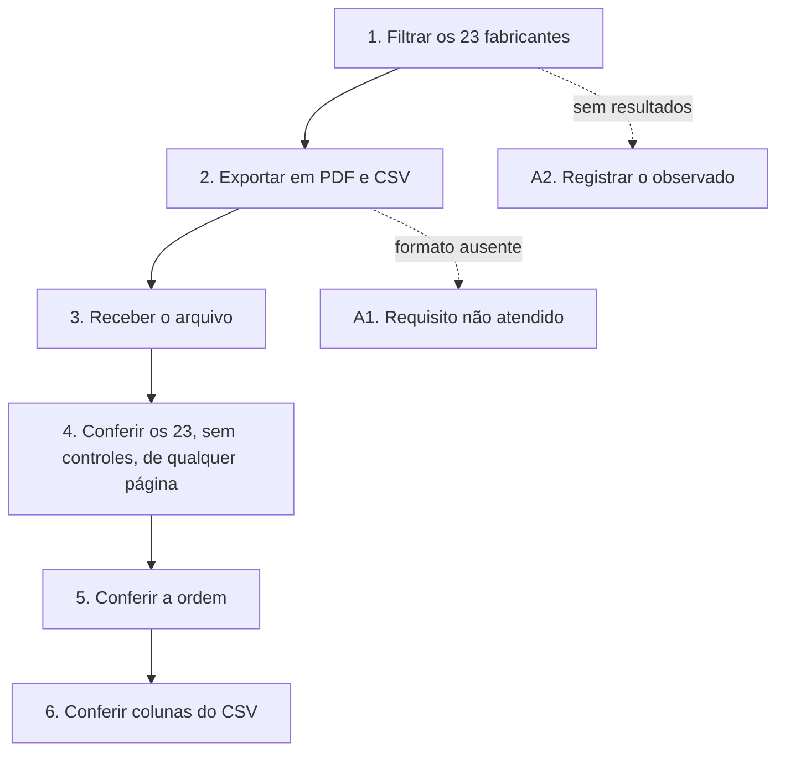

# UCS008 — Exportar consulta filtrada de fabricantes em todos os formatos

[Índice de fluxos](../fluxos.md) · [README](../../README.md) · [Cenário no formato do professor (.py)](../../functional_tests/ativos/marcas/UCS008_exportacao_1.py) · [Pendências](../pendencias.md#ucs008)

## Objetivo

Verificar que a exportação coletiva traz todos os fabricantes do filtro, em PDF e CSV e na ordem da consulta, mesmo quando o resultado ocupa várias páginas.

## Requisitos

- Feature #35912 — Exportação de fabricantes. Relacionadas: Consulta #24273 e US #25954.
- Tópicos da consolidação: formatos de exportação, resultado completo da consulta, filtros, dados do arquivo, entrega do arquivo e ordenação.

## Ator

Administrador. O critério Autorização da Feature exige apenas autorização para consultar a listagem (exportação coletiva); o cenário usa o Administrador, que tem essa autorização. A recusa sem autorização é verificada no UCS010.

## Pré-condições

- Ambiente de teste isolado, com a massa abaixo já cadastrada.

## Dados de teste

- 23 fabricantes fictícios ESTUDO-MARCAS-01 a 23 que atendem ao filtro.
- 3 fabricantes CONTROLE-01 a 03 que não atendem.
- Consulta com páginas de 10 registros, para o resultado ocupar três páginas.
- Filtro disponível: busca por fabricante.

## Fluxo principal

1. **Filtrar.** Aplicar um filtro que selecione os 23 fabricantes de estudo. **Esperado:** total de 23, sem os controles.
2. **Exportar em cada formato.** Escolher uma ordenação e solicitar PDF e, depois, CSV. **Esperado:** cada arquivo no formato pedido.
3. **Receber o arquivo.** **Esperado:** download iniciado e resultado informado.
4. **Conferir o conjunto.** **Esperado:** os 23 fabricantes estão no arquivo e nenhum controle. Repetir a exportação a partir de outra página: o conjunto continua completo.
5. **Conferir a ordem.** **Esperado:** mesma ordem da consulta.
6. **Conferir o CSV.** **Esperado:** colunas Nome, Site Oficial, E-mail de Suporte e Telefone de Suporte, com os valores dos registros.

## Fluxos alternativos

- **A1. Formato ausente.** Se o sistema não oferecer PDF ou CSV, registrar o requisito como não atendido; os dois são obrigatórios.
- **A2. Consulta vazia.** Exportar um filtro sem resultados e registrar o comportamento observado (ainda não definido).

## Regras de negócio

- A exportação coletiva oferece PDF e CSV; a ficha individual é em PDF (UCS009).
- A exportação contém todos os registros do filtro, e não só os da página exibida.
- O arquivo segue a ordenação da consulta.
- As colunas do CSV vêm do levantamento e ainda não constam dos CAs da Feature #35912; o conteúdo do PDF não está definido.

## Diagrama

## Pendências

Composição das colunas do CSV, conteúdo do PDF e comportamento com consulta vazia. Detalhes em [pendências do UCS008](../pendencias.md#ucs008).
