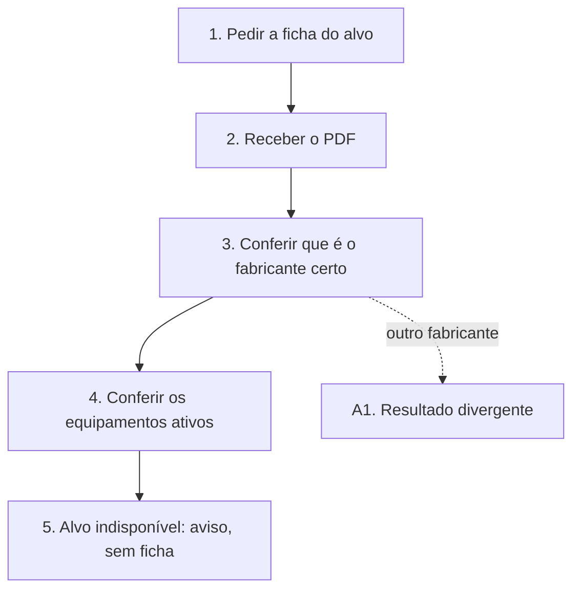

# UCS009 — Exportar ficha individual de fabricantes

[Índice de fluxos](../fluxos.md) · [README](../../README.md) · [Cenário no formato do professor (.py)](../../functional_tests/ativos/marcas/UCS009_exportacao_2.py) · [Pendências](../pendencias.md#ucs009)

## Objetivo

Verificar que a ficha em PDF corresponde ao fabricante escolhido, lista seus equipamentos ativos e, se o fabricante estiver indisponível, gera aviso em vez da ficha de outro registro.

## Requisitos

- Feature #35912 — Exportação de fabricantes. Relacionadas: Consulta #24273 e US #25954.
- Tópicos da consolidação: arquivo individual, registro individual indisponível, entrega do arquivo e ativos da marca.

## Ator

Administrador. O critério Autorização da Feature exige apenas autorização para visualizar o registro (exportação individual); o cenário usa o Administrador, que tem essa autorização. A recusa sem autorização é verificada no UCS010.

## Pré-condições

- Ambiente de teste isolado, com a massa abaixo já cadastrada.

## Dados de teste

- Fabricante fictício ESTUDO-MARCAS-01 (alvo), com dois equipamentos ativos vinculados e um equipamento excluído.
- Fabricante CONTROLE-01 e um equipamento de outra marca, que não podem aparecer na ficha do alvo.

## Fluxo principal

1. **Solicitar a ficha.** Selecionar ESTUDO-MARCAS-01 na consulta e pedir a ficha em PDF.
2. **Receber o arquivo.** **Esperado:** download iniciado e resultado informado.
3. **Conferir a identidade.** **Esperado:** o PDF identifica ESTUDO-MARCAS-01, e não CONTROLE-01. Um PDF coletivo não vale como ficha.
4. **Conferir os equipamentos.** **Esperado:** a ficha lista os dois equipamentos ativos, com série, tipo e situação; o excluído e o de outra marca não aparecem.
5. **Fabricante indisponível.** Repetir a solicitação com um alvo que deixou de estar disponível. **Esperado:** indisponibilidade informada, sem entregar a ficha de outro registro.

## Fluxos alternativos

- **A1. Fabricante diferente no PDF.** Se o PDF identificar outro fabricante, o resultado é divergente, mesmo que o arquivo exista.

## Regras de negócio

- A ficha individual é um PDF do registro selecionado.
- A ficha lista os equipamentos não excluídos vinculados ao fabricante (CAs da Feature #35912, a validar).
- Os demais campos da ficha ainda não estão definidos; até lá, a avaliação desses campos fica bloqueada.

## Diagrama

## Pendências

Indicação de download e campos completos da ficha em PDF. Detalhes em [pendências do UCS009](../pendencias.md#ucs009).
