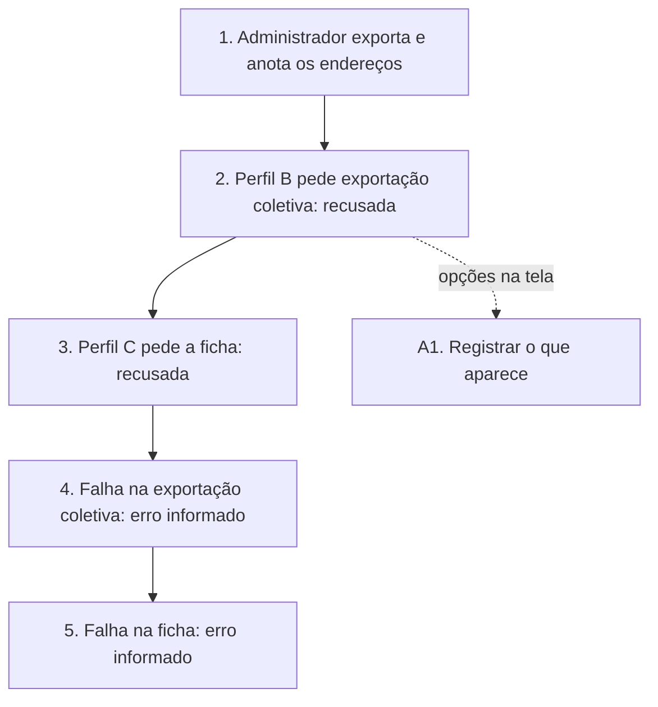

# UCS010 — Tratar autorização e falha de exportação de fabricantes

[Índice de fluxos](../fluxos.md) · [README](../../README.md) · [Cenário no formato do professor (.py)](../../functional_tests/ativos/marcas/UCS010_exportacao_3.py) · [Pendências](../pendencias.md#ucs010)

## Objetivo

Verificar que cada modalidade de exportação de fabricantes exige a sua autorização, que o andamento é indicado e que uma falha é informada sem entregar o erro como relatório.

## Requisitos

- Feature #35912 — Exportação de fabricantes. Relacionadas: Consulta #24273 e US #25954.
- Critério Autorização da Feature: a exportação coletiva exige autorização para consultar a listagem; a ficha individual exige autorização para visualizar o registro; sem a autorização correspondente, a solicitação é recusada. A separação entre listar e visualizar também consta do CA-2.1.4.1.2.01.
- Tópicos da consolidação: autorização, falha na obtenção do arquivo e exportação em andamento.

## Ator

- **Administrador (ator principal):** tem autorização para consultar a listagem e visualizar o registro; prepara a massa, faz as exportações permitidas e confere os resultados.
- **Outros atores**, perfis criados só para este teste, e não papéis novos do produto:
  - **Usuário do Perfil B:** sem autorização para consultar a listagem.
  - **Usuário do Perfil C:** pode consultar a listagem, mas não visualizar o registro.

## Pré-condições

- Ambiente de teste isolado, com a massa já cadastrada.
- Possibilidade de provocar uma falha controlada na obtenção do arquivo.

## Dados de teste

- Fabricante fictício ESTUDO-MARCAS-01 e uma consulta filtrada que o inclua.

## Fluxo principal

1. **Controle.** O Administrador solicita a exportação coletiva e a ficha de ESTUDO-MARCAS-01 e anota o endereço e a solicitação usados. **Esperado:** durante a preparação, o sistema indica o andamento e não aceita novo acionamento; os arquivos são entregues.
2. **Sem consulta.** O usuário do Perfil B solicita a exportação coletiva, inclusive pelo endereço anotado no passo 1, sem usar os botões da tela. **Esperado:** exportação recusada e nenhum relatório entregue.
3. **Sem visualização.** O usuário do Perfil C solicita a ficha de ESTUDO-MARCAS-01, inclusive pelo endereço anotado. **Esperado:** exportação recusada e nenhuma ficha entregue.
4. **Falha na exportação coletiva.** Com a falha controlada ativa, o Administrador solicita a exportação coletiva. **Esperado:** falha informada; o conteúdo do erro não é entregue como relatório.
5. **Falha na ficha.** Com a mesma falha, o Administrador solicita a ficha de um fabricante existente. **Esperado:** falha informada; o erro não é apresentado como ficha.

## Fluxos alternativos

- **A1. Opções na interface.** Com os Perfis B e C, registrar se as opções de exportação aparecem na tela. Os critérios não exigem escondê-las, e escondê-las não substitui a recusa dos passos 2 e 3.

## Regras de negócio

- Cada modalidade exige a sua autorização: consultar a listagem não autoriza a ficha.
- Qualquer arquivo entregue nos passos 2 e 3 é defeito de controle de acesso.
- Indicação de andamento (CA03) e tratamento de falha (CA01) da Feature #35912, a validar.
- Nova tentativa e retomada após falha não estão definidas.

## Diagrama

## Pendências

Registro do critério Autorização na Feature publicada, forma de apresentar a recusa e validação do andamento e da falha. Detalhes em [pendências do UCS010](../pendencias.md#ucs010).
