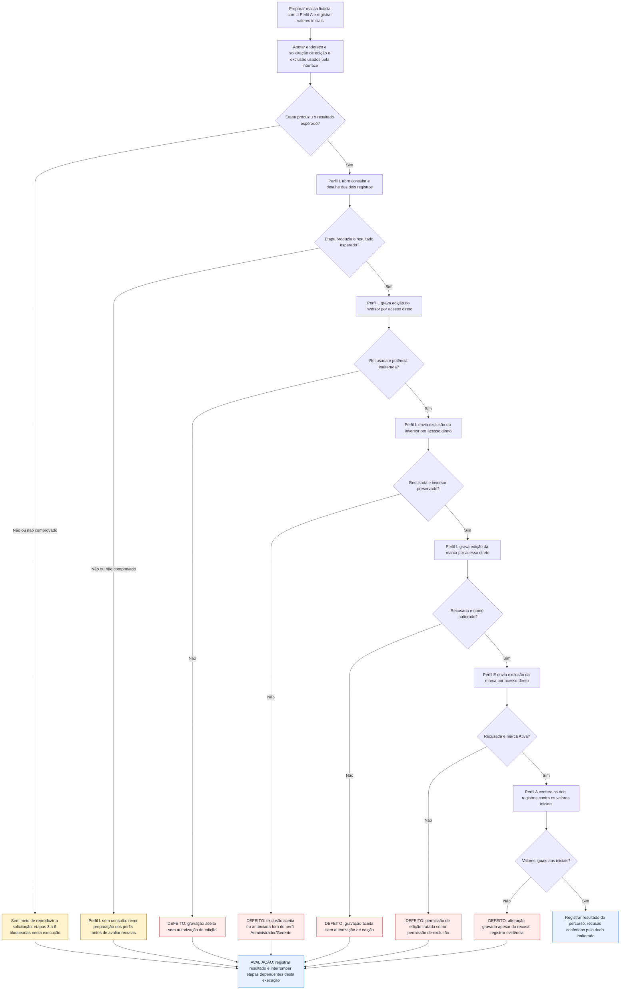

# UCS011 — Recusar edição e exclusão por acesso direto sem permissão

[Índice de fluxos](../fluxos.md) · [README](../../README.md) · [Cenário no formato do professor (.py)](../../functional_tests/ativos/UCS011_acesso_direto_sem_permissao.py)

Os losangos representam a avaliação da etapa no cenário, não novos controles da interface. Neste cenário negativo, a **recusa é o resultado esperado**: uma gravação aceita é defeito de controle de acesso, mesmo que a interface esconda a opção. As recusas vêm diretamente dos critérios citados; a forma da recusa (mensagem, código, redirecionamento) não é exigida.

## Fluxo visual

## Falhas, recusas e pendências por etapa

| Etapa ou variante | Resposta prevista ou pendência | Base |
| --- | --- | --- |
| 1. Anotar o acesso direto | Sem meio de reproduzir a solicitação, as etapas 3 a 6 ficam BLOQUEADAS nesta execução; não é falha do sistema. | Técnica de teste do cenário |
| 2. Perfil L consulta os registros | Acesso permitido. Se negado, rever a preparação dos perfis antes de avaliar as recusas. | CA-2.1.1.2.01 (#24439) |
| 3. Editar inversor por acesso direto | Recusa; potência continua 5 kW. Gravação aceita é defeito. | CA-2.1.1.3.01 |
| 4. Excluir inversor por acesso direto | Recusa, não apresentada como exclusão concluída; inversor preservado e Ativo. | CA-2.1.1.4.01 (#24473), CA-2.1.1.4.06 |
| 5. Editar marca por acesso direto | Recusa; nome inalterado. | CA-2.1.4.1.3.01 (US #24594) |
| 6. Excluir marca com permissão só de edição | Recusa; marca preservada e Ativa. | CA-2.1.4.1.4.01 (#24595) |
| 7. Conferir inalteração | Valores iguais aos iniciais. Divergência é defeito de controle de acesso. | Oráculo do cenário |
| A2. Status do inversor | Recusa; Status inalterado. | CA-2.1.1.3.01, US #29059 |
| A3. Sem autenticação | Recusa; cadastro inalterado. Forma da recusa não exigida. | CA-2.1.1.3.01 |

## Especificação completa

Autoria / responsável acadêmico: Diogo Bruno Ferreira Martins de Aguiar
Preparação assistida por IA; revisão humana e apresentação pendentes.
Revisão documental: 06/11/2026. Criação: 06/11/2026. Revisão-base: 5f3072939bb7ce5f90b64bf0faa5483bbb0d3260
Natureza: cenário documental; não é teste automatizado; não executado.
Grupos: Gestão de Inversores e Cadastro de Marcas (Fabricantes). O arquivo fica em
functional_tests/ativos/ porque o mesmo controle de acesso é verificado nos dois grupos.

### OBJETIVO

Verificar que a restrição de edição e exclusão vale para a operação, e não apenas para
o que a interface exibe: um perfil sem a autorização correspondente que solicita a
operação diretamente, sem usar os controles da tela, deve ser recusado, e os cadastros
devem permanecer inalterados. É um cenário negativo de controle de acesso; não cria
regra nova, apenas aplica uma técnica de teste às regras de autorização já definidas.

### REQUISITOS RELACIONADOS

Inversores:
- Consulta #24249 — CA #24439 (CA-2.1.1.2.01): autorização para listar não deve ser
  tratada como autorização para editar ou excluir.
- Atualização #24253 — CA-2.1.1.3.01: somente usuário autenticado com autorização para
  editar ativos pode salvar alterações cadastrais ou alterar o Status; a autorização de
  consulta, sozinha, não autoriza essas operações. US #29059 (alterar status).
- Exclusão #24254 — CA #24473 (CA-2.1.1.4.01): exclusão restrita aos perfis Administrador
  ou Gerente. CA-2.1.1.4.06: recusa não deve ser apresentada como exclusão concluída.
Fabricantes:
- Atualização #24275 — US #24594 (CA-2.1.4.1.3.01): editar marcas exige autorização de
  edição do cadastro correspondente; listar não autoriza gravar alterações.
- Exclusão #24278 — CA #24595 (CA-2.1.4.1.4.01): somente administradores podem remover
  marcas; permissão de consulta ou edição não substitui essa restrição.
Os testes "Sem autorização", "Alteração sem autorização" e "Sem permissão de alteração"
das rastreabilidades das Features de origem são a base deste cenário.

### SITUAÇÃO DAS REGRAS E BLOQUEIOS

As recusas esperadas vêm diretamente dos critérios acima; não são acréscimos a validar.
A forma da recusa (mensagem, código de resposta, redirecionamento) não está definida e
não é exigida. A equivalência entre os nomes Administrador/Gerente e os perfis do sistema
continua pendente; por isso os perfis negativos abaixo não usam nenhum desses perfis.
Não há regra de restrição por registro (dono do cadastro): este cenário não testa troca
de identificador entre registros por um perfil que tenha a autorização da operação.

### ATOR

Perfis sintéticos para esta análise, não novos papéis do produto:
- Perfil L: autenticado, com autorização para listar e visualizar ativos e marcas; sem
  autorização para editar ou excluir; não é Administrador nem Gerente.
- Perfil E: autenticado, com autorização para editar marcas; não é administrador.
- Perfil A: Administrador, usado apenas para preparar a massa e conferir os dados.

### PRÉ-CONDIÇÕES

- Ambiente futuro de estudo isolado, sem dados de produção ou ações reais nesta entrega.
- Massa sintética criada pelo Perfil A antes do fluxo; valores iniciais registrados.
- A recusa é avaliada pela operação solicitada, e não pela ausência de botão na tela.

### DADOS DE TESTE

Inversor INV-ESTUDO-ACESSO-001, Potência Nominal 5 kW, Situação Ativo, sem painéis
vinculados nem histórico; demais campos obrigatórios e vínculos como na massa de UCS001.
Marca Estudo Acesso, Situação Ativo, com e-mail de suporte suporte@marca-estudo.invalid;
demais campos obrigatórios como na massa de UCS002. Valor tentado na edição do inversor: 6 kW; na marca:
Marca Estudo Acesso Alterada. Nomes e valores são fictícios e servem apenas de entrada.

### [FP] FLUXO PRINCIPAL

1. PREPARAR O ACESSO DIRETO. Com o Perfil A, abrir a edição e a solicitação de exclusão
   de cada registro pela interface e anotar o endereço e a solicitação usados, sem
   confirmar nenhuma alteração. Essa anotação é técnica de teste, não regra do sistema.
2. CONTROLE DE AUTENTICAÇÃO. Com o Perfil L, abrir a consulta e o detalhe dos dois
   registros. Esperado: acesso permitido (CA-2.1.1.2.01). Isso mostra que as recusas
   seguintes decorrem da falta de autorização, e não de falta de login.
3. EDITAR INVERSOR SEM PERMISSÃO. Com o Perfil L, abrir diretamente o endereço de edição
   de INV-ESTUDO-ACESSO-001 e solicitar a gravação de 6 kW, sem usar o botão da tela.
   Esperado: recusa; potência continua 5 kW (CA-2.1.1.3.01).
4. EXCLUIR INVERSOR SEM PERMISSÃO. Com o Perfil L, enviar diretamente a solicitação de
   exclusão de INV-ESTUDO-ACESSO-001. Esperado: recusa, não apresentada como exclusão
   concluída; inversor preservado e Ativo (CA-2.1.1.4.01 e CA-2.1.1.4.06).
5. EDITAR MARCA SEM PERMISSÃO. Com o Perfil L, abrir diretamente o endereço de edição da
   Marca Estudo Acesso e solicitar a gravação do novo nome. Esperado: recusa; nome
   inalterado (CA-2.1.4.1.3.01).
6. EXCLUIR MARCA COM PERMISSÃO SÓ DE EDIÇÃO. Com o Perfil E, enviar diretamente a
   solicitação de exclusão da Marca Estudo Acesso. Esperado: recusa; marca preservada e
   Ativa, sem passar a Inativa (CA-2.1.4.1.4.01: permissão de edição não substitui).
7. CONFERIR INALTERAÇÃO. Com o Perfil A, consultar os dois registros e comparar com os
   valores iniciais: potência 5 kW, nome original da marca, situações Ativo.

### [A] FLUXOS ALTERNATIVOS

1. Pela interface. Com o Perfil L, abrir a consulta e observar as opções de editar e
   excluir. Registrar o que a tela apresenta, sem exigir forma específica: os critérios
   não determinam ocultar ou desabilitar a opção. Ocultar a opção não substitui a
   recusa verificada nos passos 3 a 6.
2. Status do inversor. Com o Perfil L, solicitar diretamente a alteração do Status de
   INV-ESTUDO-ACESSO-001. Esperado: recusa; Status inalterado (CA-2.1.1.3.01, US #29059).
3. Sem autenticação. Sem sessão iniciada, abrir diretamente o endereço de edição do
   inversor e solicitar a gravação. Esperado: recusa; cadastro inalterado
   (CA-2.1.1.3.01: somente usuário autenticado). A forma da recusa não é exigida.

### REGRAS DE NEGÓCIO E ORÁCULO

- O oráculo principal é o dado: nenhuma alteração gravada e nenhuma operação anunciada
  como concluída. Ausência de botão na tela não é prova de recusa.
- Autorização de listar ou visualizar não concede editar ou excluir; autorização de
  editar marcas não concede excluir marcas.
- Não definir mensagens literais, códigos de resposta, redirecionamentos ou registro
  de tentativas recusadas, porque os critérios não os definem.

### RESULTADOS ESPERADOS E REGISTRO FUTURO

- Comparar os valores iniciais com os valores conferidos no passo 7.
- Em futura execução, anotar versão, data, perfil, passo, solicitação enviada, esperado,
  observado e evidência.
- Qualquer gravação aceita nos passos 3 a 6 ou nos alternativos é defeito de controle
  de acesso, mesmo que a interface esconda a opção.
- Nesta entrega: nenhum resultado observado; nenhum teste executado; sem homologação.

### PENDÊNCIAS PARA STAKEHOLDERS

Equivalência dos perfis Administrador/Gerente com as autorizações do sistema; forma de
apresentar a recusa; se tentativas recusadas devem constar da auditoria (os critérios
só exigem auditoria das operações efetuadas); resultado de sessão expirada no meio do
fluxo. Nenhuma dessas definições é necessária para avaliar os passos 2 a 7.
