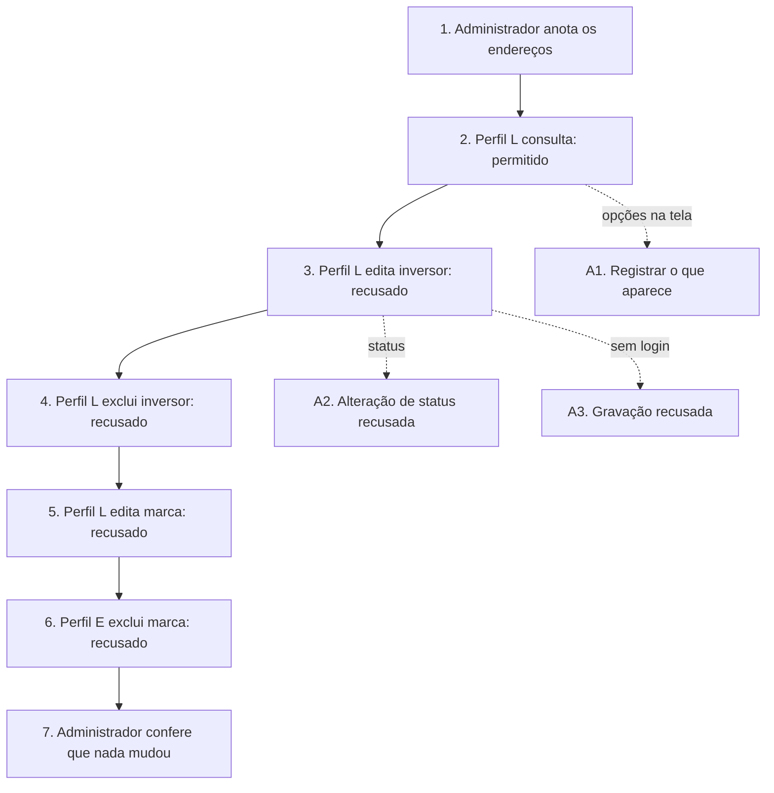

# UCS011 — Recusar edição e exclusão por acesso direto sem permissão

[Índice de fluxos](../fluxos.md) · [README](../../README.md) · [Cenário no formato do professor (.py)](../../functional_tests/ativos/UCS011_acesso_direto_sem_permissao.py) · [Pendências](../pendencias.md#ucs011)

## Objetivo

Verificar que a restrição de edição e exclusão vale para a operação, e não só para o que a tela mostra: quem não tem a autorização e solicita a operação diretamente, sem usar os botões, é recusado, e os dados não mudam. Cobre inversores e marcas, porque o mesmo controle de acesso vale para os dois.

## Requisitos

- Inversores: Consulta #24249 — CA #24439 (CA-2.1.1.2.01); Atualização #24253 — CA-2.1.1.3.01 e US #29059 (alterar status); Exclusão #24254 — CA #24473 (CA-2.1.1.4.01) e CA-2.1.1.4.06.
- Marcas: Atualização #24275 — US #24594 (CA-2.1.4.1.3.01); Exclusão #24278 — CA #24595 (CA-2.1.4.1.4.01).
- Base: os testes "Sem autorização", "Alteração sem autorização" e "Sem permissão de alteração" das Features de origem.

## Ator

- **Administrador (ator principal):** prepara a massa e confere os dados; não faz as tentativas sem permissão.
- **Outros atores**, perfis criados só para este teste, e não papéis novos do produto:
  - **Usuário do Perfil L:** autenticado, pode listar e visualizar ativos e marcas; não pode editar nem excluir; não é Administrador nem Gerente.
  - **Usuário do Perfil E:** autenticado, pode editar marcas; não é administrador.

## Pré-condições

- Ambiente de teste isolado.
- Massa criada pelo Administrador antes do fluxo, com os valores iniciais anotados.

## Dados de teste

| Registro | Valores iniciais | Valor tentado |
| --- | --- | --- |
| Inversor INV-ESTUDO-ACESSO-001 | 5 kW, Ativo, sem painéis nem histórico | 6 kW |
| Marca Estudo Acesso | Ativo, e-mail suporte@marca-estudo.invalid | Marca Estudo Acesso Alterada |

## Fluxo principal

1. **Preparar o acesso direto.** Como Administrador, abrir a edição e a exclusão de cada registro pela interface e anotar o endereço e a solicitação usados, sem confirmar nada.
2. **Controle de autenticação.** O usuário do Perfil L abre a consulta e o detalhe dos dois registros. **Esperado:** acesso permitido, o que mostra que as recusas seguintes vêm da falta de autorização, e não da falta de login (CA-2.1.1.2.01).
3. **Editar inversor sem permissão.** O usuário do Perfil L abre diretamente o endereço de edição do inversor e solicita gravar 6 kW. **Esperado:** recusa; a potência continua 5 kW (CA-2.1.1.3.01).
4. **Excluir inversor sem permissão.** O usuário do Perfil L envia diretamente a solicitação de exclusão do inversor. **Esperado:** recusa, sem anunciar exclusão concluída; o inversor continua Ativo (CA-2.1.1.4.01 e .06).
5. **Editar marca sem permissão.** O usuário do Perfil L abre diretamente o endereço de edição da marca e solicita gravar o novo nome. **Esperado:** recusa; o nome não muda (CA-2.1.4.1.3.01).
6. **Excluir marca com permissão só de edição.** O usuário do Perfil E envia diretamente a solicitação de exclusão da marca. **Esperado:** recusa; a marca continua Ativa (CA-2.1.4.1.4.01).
7. **Conferir que nada mudou.** Como Administrador, consultar os dois registros. **Esperado:** 5 kW, nome original da marca e as duas situações Ativo.

## Fluxos alternativos

- **A1. Opções na interface.** O usuário do Perfil L abre a consulta, e o Administrador registra se as opções de editar e excluir aparecem. Os critérios não exigem escondê-las, e escondê-las não substitui a recusa dos passos 3 a 6.
- **A2. Status do inversor.** O usuário do Perfil L solicita diretamente a alteração do status do inversor. **Esperado:** recusa; status inalterado (CA-2.1.1.3.01, US #29059).
- **A3. Sem autenticação.** Sem sessão iniciada, alguém abre diretamente o endereço de edição do inversor e solicita a gravação. **Esperado:** recusa; cadastro inalterado (CA-2.1.1.3.01).

## Regras de negócio

- Autorização para listar ou visualizar não concede editar ou excluir; autorização para editar marcas não concede excluí-las.
- A prova da recusa é o dado inalterado: qualquer gravação aceita nos passos 3 a 6 é defeito de controle de acesso, mesmo que a tela esconda a opção.
- A forma da recusa (mensagem, código de resposta ou redirecionamento) não está definida e não é exigida.

## Diagrama

## Pendências

Equivalência dos perfis Administrador/Gerente, forma de apresentar a recusa e registro das tentativas recusadas na auditoria. Nenhuma delas impede avaliar os passos 2 a 7. Detalhes em [pendências do UCS011](../pendencias.md#ucs011).
